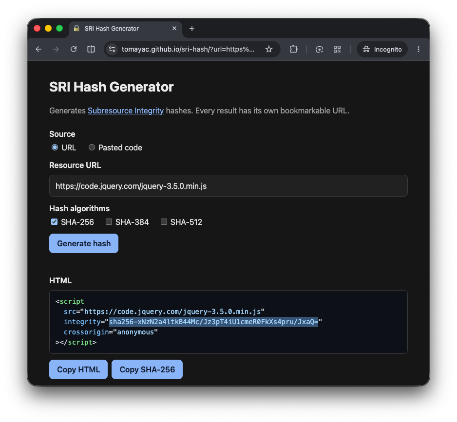
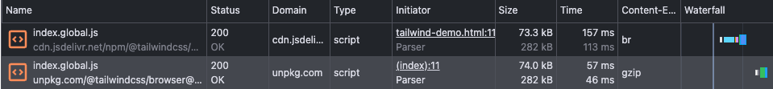
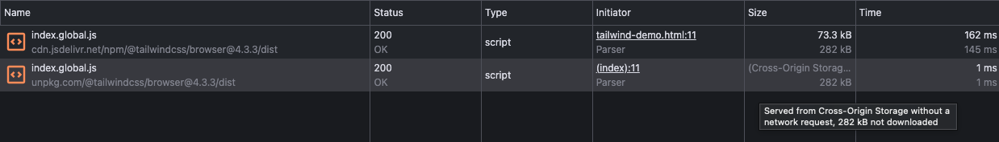
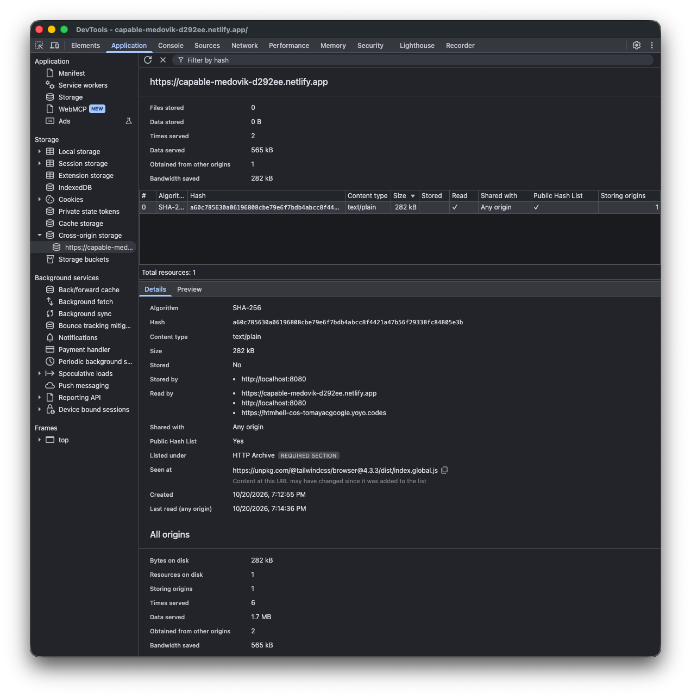
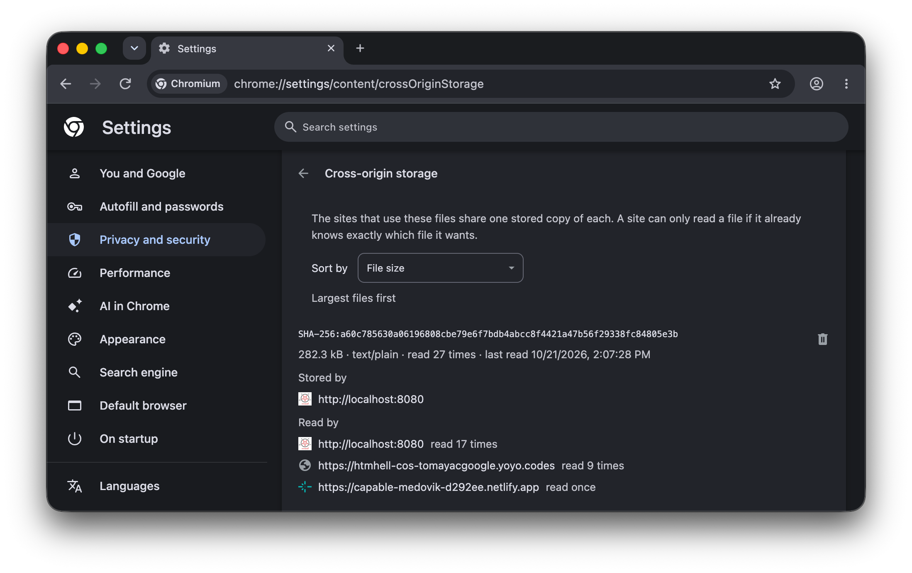

Remember the "good old days" when we were all told to [use a CDN](https://web.archive.org/web/20130414101422/https://developer.yahoo.com/blogs/ydn/high-performance-sites-rule-2-content-delivery-network-7173.html) and to [agree on the same CDN URLs](https://web.archive.org/web/20081211172457/https://encosia.com/2008/12/10/3-reasons-why-you-should-let-google-host-jquery-for-you/) for maximum performance due to HTTP cache hits?

## The "good old days"

Let's teleport us all back to the times when saying "HTML5" was considered cutting-edge. HTML5 Rocks. HTML5 Doctor. HTML5 Boilerplate. Rings a bell? Alright, let's dive in then! Up until [h5bp/html5-boilerplate#2225](https://github.com/h5bp/html5-boilerplate/pull/2225/changes), the, at the time, highly popular [HTML5 Boilerplate](https://html5boilerplate.com/) template included the following HTML snippet with two `<script>` tags:

```html
<script
    src="https://code.jquery.com/jquery-3.5.0.min.js"
    integrity="sha256-xNzN2a4ltkB44Mc/Jz3pT4iU1cmeR0FkXs4pru/JxaQ="
    crossorigin="anonymous"
></script>
<script>
  window.jQuery || document.write('<script src="js/vendor/jquery-3.5.0.min.js"><\/script>')
</script>
```

### The first `<script>` tag

There's a lot going on here, so let's unpack what's in the first `<script>` tag.

* `src="https://code.jquery.com/jquery-3.5.0.min.js"`: This points at a specific [versioned URL of jQuery](https://code.jquery.com/jquery-3.5.0.min.js) on the official [jQuery CDN](https://releases.jquery.com/).
* `integrity="sha256-xNzN2a4ltkB44Mc/Jz3pT4iU1cmeR0FkXs4pru/JxaQ="`: This is a [Subresource Integrity](/adventcalendar/2022/3/) (SRI) hash that ensures the fetched file has not been tampered with.
* `crossorigin="anonymous"`: Cross-origin requests (from the site using the boilerplate to the CDN) that use Subresource Integrity must use the [Cross-Origin Resource Sharing](https://developer.mozilla.org/en-US/docs/Web/HTTP/Guides/CORS) (CORS) protocol. The `crossorigin` attribute is needed because, by default, a resource loaded from a document's HTML is loaded in `no-cors` mode.

#### Trust, but verify

Using third-party CDNs _without_ `integrity` requires you to trust the CDN provider to not tamper with the files being served. HTML5 Boilerplate blindly trusted the jQuery CDN until [h5bp/html5-boilerplate#1904](https://github.com/h5bp/html5-boilerplate/pull/1904/changes) landed. And because on the Internet we can't have nice things, eventually what had to happen happened: this naive trust in CDNs to always be a good thing was eventually eroded by incidents like the [polyfill.io takeover](https://blog.cloudflare.com/automatically-replacing-polyfill-io-links-with-cloudflares-mirror-for-a-safer-internet/).

Luckily, HTML5 Boilerplate itself was spared, and the jQuery CDN did _not_ tamper with the data it serves, which you can verify with my [SRI Hash Generator](https://tomayac.github.io/sri-hash/?url=https%3A%2F%2Fcode.jquery.com%2Fjquery-3.5.0.min.js&algorithm=sha256). The highlighted hash in the screenshot matches the one from the code snippet earlier in the article.



<p class="highlight"><strong>Note:</strong>
  Rather than use mine, better use an established <a href="https://srihash.org/">SRI hash generator</a>! I couldn't find a generator that would let me create linkable URLs, so I created one, but also because I could have just hard-coded my generator to always spit out the expected hash. Trust no one on the Internet, trust me, bro!
</p>

Had the jQuery CDN tampered with the data, the calculated hash wouldn't match the expected hash, `sha256-xNzN2a4ltkB44Mc/Jz3pT4iU1cmeR0FkXs4pru/JxaQ=`, and the browser would have outright refused to load the script.

### The second `<script>` tag

This is then where the second `<script>` of the boilerplate comes into play: the fallback script that loads a self-served copy of jQuery in case the CDN version fails. It first checks if `window.jQuery` is defined, which is the case if the CDN version has loaded successfully, and if not, it dynamically writes a `<script>` tag to load the local version.

## Why can't we have nice things on the Internet?

Remember how I wrote before that on the Internet we can't have nice things? This is true because of malicious takeovers like in the case of polyfill<span>.</span>io, but also because of a general type of attack that's based on timing how long a resource took to load. For example, imagine an attacker wanted to track you across different websites.

On site&nbsp;A, the attacker might load a script they minted just for you for the sole purpose of the attack (so no other site can have cached it before). On site&nbsp;B, which the attacker suspects you to also frequent, they then load the same script. By comparing the load times, they can potentially correlate your visits across these sites. (On site&nbsp;B, the script gets served faster from the HTTP cache than from the network if you were on site&nbsp;A before.) This type of attack is known as a [cache-timing attack](https://en.wikipedia.org/wiki/Cross-site_leaks#Cache-timing_attacks), and it was used, for example, to stage [cross-site leak](https://sirdarckcat.blogspot.com/2019/03/http-cache-cross-site-leaks.html) attacks.

## Cache isolation

While the problem of tampered-with code is solved by Subresource Integrity (SRI) without any collateral damage (apart from the slight but automatable annoyance of having to update the hash whenever the code changes), cache-timing attacks required browsers to pull out the sledgehammer and completely isolate all their caches, rendering the above attack impossible, but also breaking all legitimate cross-origin caching with CDNs and common resources like jQuery (or today React, Vue, etc.).

Since 2020, all major browsers have isolated their caches:

* [Safari by top-level `eTLD+1`](https://webkit.org/blog/8613/intelligent-tracking-prevention-2-1/#:~:text=their%20shorter%20expiry.-,Verified%20Partitioned%20Cache,-WebKit%20implemented%20partitioned)
* [Chrome by top-level `scheme://eTLD+1` and frame `scheme://eTLD+1`](https://developer.chrome.com/blog/http-cache-partitioning/)
* [Firefox by top-level `scheme://eTLD+1`](https://blog.mozilla.org/security/2021/01/26/supercookie-protections/)

## Why we might be able to have nice-ish things

On the Chrome team, we're working on bringing some of the legitimate cross-origin caching benefits back to the browser with a new dedicated API called [Cross-Origin Storage](https://github.com/WICG/cross-origin-storage/) (COS). COS is a _content-addressable_ browser cache that shares files _across origins_ by hash, with availability gating based on _k-anonymity_ to prevent cross-site tracking. Again that's a lot to digest, so let's break it down.

## Content addressability

Usually when we want to address resources on the Web, we use URLs, Unique Resource Locators. An example is `https://code.jquery.com/jquery-3.5.0.min.js`. It uniquely _addresses_ a resource, but without integrity checks, we can't guarantee that it actually serves _in_ the tin what it says _on_ the tin. By shifting our thinking from _where_ a resource is located to _what_ it is, we arrive at content addressability. If we say "a resource is identified by hash `sha256-xNzN2a4ltkB44Mc/Jz3pT4iU1cmeR0FkXs4pru/JxaQ=`", we can safely share it across origins without worrying about tampering. We went from a URL to a URI, a Uniform Resource Identifier, that identifies the resource by its content rather than its location.

Remember how at the very beginning of the article I wrote that we were told to "agree on the same CDN URLs"? This is in fact what made the effects of cache isolation not as drastic as you intuitively might have thought they would be. Turns out, most developers did _not_ agree on the same URLs (and versions), so both [Chrome](https://developer.chrome.com/blog/http-cache-partitioning#what_is_the_impact_of_this_behavioral_change) and [Firefox](https://blog.mozilla.org/security/2021/01/26/supercookie-protections/#:~:text=Our%20metrics%20show%20a%20very%20modest%20impact%20on%20page%20load%20time%3A%20between%20a%200.09%25%20and%200.75%25%20increase%20at%20the%2080th%20percentile%20and%20below%2C%20and%20a%20maximum%20increase%20of%201.32%25%20at%20the%2085th%20percentile.) observed relatively modest impact of cache isolation on actual page load times.

Back to jQuery. Is the jQuery addressed by
`https://unpkg.com/jquery@3.5.0/dist/jquery.min.js` the same jQuery as the one addressed by `https://code.jquery.com/jquery-3.5.0.min.js`? The answer is yes, confirmed by my [SRI Hash Generator](https://tomayac.github.io/sri-hash/?url=https://unpkg.com/jquery@3.5.0/dist/jquery.min.js&algorithm=sha256) (that, again, I invite you to verify against whatever SRI hash generator you trust).

The problem now is that to the browser, despite the matching `integrity` attributes, they are still considered two different resources because they have different URLs requested from different origins. Or more concretely, if this is your site…

```html
<!-- Your site -->
<script
    src="https://code.jquery.com/jquery-3.5.0.min.js"
    integrity="sha256-xNzN2a4ltkB44Mc/Jz3pT4iU1cmeR0FkXs4pru/JxaQ="
    crossorigin="anonymous"
></script>
```

…and this is my site…

```html
<!-- My site -->
<script
  src="https://unpkg.com/jquery@3.5.0/dist/jquery.min.js"
  integrity="sha256-xNzN2a4ltkB44Mc/Jz3pT4iU1cmeR0FkXs4pru/JxaQ="
  crossorigin="anonymous"
></script>
```

…the browser will download the same resource for both sites redundantly.

Cross-Origin Storage aims to enable browsers to recognize and share identical resources across different origins, reducing redundant downloads and improving performance.

## Cross-Origin Storage

The proposed COS API introduces an imperative [`navigator.crossOriginStorage.getFileHandle()`](https://github.com/WICG/cross-origin-storage/#the-imperative-api) API through which web apps store and retrieve large files across origin boundaries, identified by a cryptographic hash. You can read all about it in the [COS explainer](https://github.com/WICG/cross-origin-storage/). But this is the HTMHell Advent Calendar, so I want to exclusively focus on the HTML integration we're proposing for the COS API.


### COS HTML Integration

At its core, the COS HTML integration is just one new attribute, `crossoriginstorage`. (No dashes, those are reserved for potential [HTML custom attributes](https://github.com/WICG/webcomponents/issues/1029), which I root for.) You add the `crossoriginstorage` attribute to your `<script>` tags as in the snippet below. The attribute takes optional values that determine the sharing level of resources.

```html
<script
  src="https://unpkg.com/jquery@3.5.0/dist/jquery.min.js"
  integrity="sha256-xNzN2a4ltkB44Mc/Jz3pT4iU1cmeR0FkXs4pru/JxaQ="
  crossoriginstorage
  crossorigin="anonymous"
></script>
```

<p class="highlight"><strong>Note:</strong>
  Despite their similar names, <code>crossoriginstorage</code> and <code>crossorigin</code> are different attributes with different purposes.
</p>

### Sharing levels

* Omitting the value (that is, just writing `crossoriginstorage`) or setting it to the empty string (`crossoriginstorage=""`) keeps the file readable by [same-site](https://web.dev/articles/same-site-same-origin#same-site-cross-site) origins only. This is the default, and it fits resources shared across all of an organization's own subdomains.
* Passing a list of space-separated origins (for instance <code>crossoriginstorage="<span>https://</span>write.example <span>https://</span>calculate.example"</code>) restricts access to those origins and their same-site origins. Use this for proprietary resources, and for anything where you don't expect global cache hits. With the list form, whoever serves the bytes needs to authorize each origin in the list using the [`Cross-Origin-Storage-Allow-Origin`](https://github.com/WICG/cross-origin-storage#the-cross-origin-storage-allow-origin-header) header.
* Choosing `crossoriginstorage="*"` makes the file globally available, subject to the availability gating through the Public Hash List described later.

### Example with Tailwind

The jQuery library is a resource that's (still) widely used across many sites, but of course it's not something you'd use today (not jQuery per se, just this particular old version). Instead, let's use something as non-controversial as Tailwind. At the time of this writing, the latest version is  `4.3.3`, and as a globally popular resource, it can be loaded from a CDN like jsDelivr with the `crossoriginstorage` attribute:

```html
<script
  src="https://cdn.jsdelivr.net/npm/@tailwindcss/browser@4.3.3/dist/index.global.js"
  integrity="sha256-pgx4VjCgYZaAjL555ve9tKvMj0QhpHtW8pM4/ISAXjs="
  crossoriginstorage="*"
  crossorigin="anonymous"
></script>
```

<p class="highlight"><strong>Note:</strong>
  Yes, I know that this is not the production way to use Tailwind CSS. It's what they call the <a href="https://tailwindcss.com/docs/installation/play-cdn">Play CDN</a> approach for trying Tailwind without a build step.
</p>

#### Today, without COS

You can see the effect of the `crossoriginstorage` attribute in action with the following iframes. Both are authorized via Permissions Policy to use Cross-Origin Storage by adding `allow="cross-origin-storage"` to the iframe elements.

* First iframe hosted on the origin [`https://www.htmhell.dev`](tailwind-demo.html) (the origin of the HTMHell site).
  <iframe style="border: 6px solid #000;" allow="cross-origin-storage" src="tailwind-demo.html" width="100%" height="150"></iframe>
* Second iframe hosted on the origin [`https://htmhell-cos-tomayacgoogle.yoyo.codes`](https://htmhell-cos-tomayacgoogle.yoyo.codes) (cross-origin from HTMHell).
  <iframe style="border: 6px solid #000;" allow="cross-origin-storage" src="https://htmhell-cos-tomayacgoogle.yoyo.codes" width="100%" height="150"></iframe>

When the browser encounters this today, _absolutely nothing_ different will happen than when you had loaded the resource _without_ `crossoriginstorage` attribute. As you can verify on the DevTools Network panel, both files are loaded independently, 282kB uncompressed, the difference only being the compression (gzip vs. brotli), which means one is slightly smaller than the other. And that's it, thanks for reading my HTMHell Advent Calendar contribution.



#### Tomorrow, with COS

Well, there's of course something more. The fact that nothing different happens today also means _nothing breaks_. COS is designed as a progressive enhancement. When you use a [special build of Chromium](https://goo.gle/cos-chromium) that has the COS API already implemented, things start to look differently.

The first iframe (or tab when you opened the demos directly) will now check and see if a resource with the hash `sha256-pgx4VjCgYZaAjL555ve9tKvMj0QhpHtW8pM4/ISAXjs=` is already stored in the COS cache. This won't be the case, so the resource will be fetched from the network from the URL it sees in the `src` attribute of the `<script>`, [`https://cdn.jsdelivr.net/npm/@tailwindcss/browser@4.3.3/dist/index.global.js`](https://cdn.jsdelivr.net/npm/@tailwindcss/browser@4.3.3/dist/index.global.js). After the download, the resource's _calculated_ hash will be checked against the _expected_ hash according to the `integrity` attribute. If the hashes match, the file can then be used and at the same time stored in COS.

When it checks for the same hash, the second iframe (or tab) will now find the resource already stored in COS and will be able to use it directly without fetching it from the network again. Should the resource not be in COS or not be usable (more about that in the next section), it will fall back to fetching it from the network as usual, but using the other URL [`https://unpkg.com/@tailwindcss/browser@4.3.3/dist/index.global.js`](https://unpkg.com/@tailwindcss/browser@4.3.3/dist/index.global.js), which is what its `<script>`'s `src` tells it to use.

The following screenshot shows the happy path, the first iframe having fetched and stored the resource, and the second iframe using it from COS.



### Availability gating

At this stage you might be wondering how undoing cache isolation doesn't re-introduce the problems of cross-origin tracking and privacy leaks. The mechanisms described below are designed to mitigate these risks while still allowing most of the benefits of shared caching (I said "nice-ish things", remember?).

<p class="highlight"><strong>Note:</strong>
  The privacy mitigations described in the following are not final yet and may evolve as the specification and implementations mature.
</p>

#### The Public Hash List

Even for resources stored with `crossoriginstorage="*"`, the browser only confirms a file's presence to an unrelated origin if the hash appears on the [Public Hash List](https://github.com/WICG/cross-origin-storage/blob/main/public-hash-list/phl-explainer.md) (PHL), a proposed shared, vendor-neutral [allowlist of hashes](https://github.com/WICG/cross-origin-storage/blob/main/public-hash-list/implementation/data/public-hash-list.dat) corroborated as appearing byte-identical across a large number of independently crawled origins. That corroboration is a form of *k*\-anonymity: once a file is that ubiquitous, its presence says nothing about any individual user. See the [PHL explainer](https://github.com/WICG/cross-origin-storage/blob/main/public-hash-list/phl-explainer.md) for more details, or view the [current PHL](https://github.com/WICG/cross-origin-storage/blob/main/public-hash-list/implementation/data/public-hash-list.dat).

The screenshot shows the COS entry of the Tailwind resource, including its metadata and the indication that it is listed on the Public Hash List.



#### GREASE'ing

For PHL-listed resources, browsers may occasionally lie and say they don't have a file they actually _do_ have, adding noise that makes a true absence harder to distinguish from a privacy-motivated false negative. The technique is named after [GREASE](https://tools.ietf.org/html/draft-ietf-tls-grease) and is also used in [UA Client Hints](https://wicg.github.io/ua-client-hints/#grease). For very large files, where a spurious re-download would be disproportionately costly, browsers must not GREASE.

#### A cross-site lookup budget

COS lets a tracker write, which turns it into a potential cross-site store. Under some circumstances, a tracker can write a resource on site&nbsp;A to store a chosen subset of small files, each file's presence encoding one bit, and read that subset back from site&nbsp;B.

With the COS HTML integration, when the tracker controls the server, they can detect COS hits by observing whether requests for those resources arrive. To prevent this, we're considering a lookup budget. Every lookup that could reveal what another site stored counts against a small budget. The budget belongs to the top-level site the user is visiting, and every frame on the page draws from it, so a tracker can't multiply it by adding origins or by moving the page through subdomains. Lookups for files your own origin stored are free. Since each lookup reveals at most one bit, a budget of \$n caps a tracker at \$n bits per window. Roughly 32 bits are needed to identify a device.

## Try it today

There are two ways to experiment with COS right now. Option&nbsp;1 allows you to continue using your current browser, but with a polyfill injected through an extension, whereas option&nbsp;2 consists of using an experimental custom browser build with the natively implemented COS API.

### Option&nbsp;1: The browser extension, easy but with caveats

A browser extension polyfills the full `navigator.crossOriginStorage` surface, plus, among others, the HTML integration, which is the topic of this blog post, so you can test the complete flow in your current browser. The extension exists for all major versions.

You can also [load the extension unpacked](https://developer.chrome.com/docs/extensions/get-started/tutorial/hello-world#load-unpacked) from its [source code](https://github.com/web-ai-community/cross-origin-storage-extension). The small caveat of the extension is that it may not perfectly replicate the loading behavior of the native implementation, as the browser's preload scanner can be faster than the extension's logic overriding it. It does, however, always populate the COS cache correctly.

| Icon | Browser | Link |
| :---- | :---- | :---- |
|  | Chrome and other Chromium-based browsers | [Chrome Web Store](https://chromewebstore.google.com/detail/cross-origin-storage/denpnpcgjgikjpoglpjefakmdcbmlgih) |
|  | Firefox (desktop and Android) | [Firefox Add-ons](https://addons.mozilla.org/en-US/firefox/addon/cross-origin-storage/) |
|  | Safari (macOS, iOS, and iPadOS) | [App Store](https://apps.apple.com/us/app/cross-origin-storage/id6788319695) |

The extension has an opt-in Public Hash List setting (off by default) that gates globally shared resources the way a real implementation would, and its popup marks every stored resource as "On PHL" or "Not on PHL" either way.

### Option&nbsp;2: An experimental Chromium build

There's a work-in-progress Chromium implementation you can run. It's an unofficial, personal build and makes no promises about shipping behavior, so treat it as a testbed. Download it for macOS on Apple silicon or Linux x86\_64 from [goo.gle/cos-chromium](https://goo.gle/cos-chromium), then open `about://flags`, search for "Cross-Origin Storage", set it to **Enabled**, and restart when prompted.

This build also includes DevTools debugging: find **Cross-origin storage** on the **Application** tab, where you can inspect every stored resource by hash, see which origins stored and read it, check whether it's on the Public Hash List, and watch the bandwidth-saved counter climb. There's also an early **Settings** exploration, available at `chrome://settings/content/crossOriginStorage`.



## Standardization status

Cross-Origin Storage is an early-stage [WICG](https://www.w3.org/community/wicg/) proposal currently being implemented in Chromium. No browser ships it on by default.

* The early [**W3C TAG Design Review**](https://github.com/w3ctag/design-reviews/issues/1254)
* Host integrations are filed with their respective standards bodies:
  * [`crossoriginstorage` attribute](https://github.com/whatwg/html/issues/12770) with the WHATWG HTML Standard
* Cross-browser [**Web Platform Tests**](https://github.com/web-platform-tests/wpt/pull/61811) (work in progress)
* Standards positions have been requested from other vendors:
  * [**Mozilla**](https://github.com/mozilla/standards-positions/issues/1427)
  * [**WebKit**](https://github.com/WebKit/standards-positions/issues/703)

Feedback on the API and on the shape of the proposal is very welcome. The [Cross-Origin Storage repository](https://github.com/WICG/cross-origin-storage/) is the place to file issues, [express support](https://github.com/WICG/cross-origin-storage/labels/expression%20of%20support), or open pull requests.

## Call to action

If your app depends on widely shared resources, Cross-Origin Storage is worth trying today. Opting in carries no risk: when COS isn't available, your code falls back to the network and today's per-origin-isolated caching, exactly as it works now. Every site that opts in makes the experience faster and cheaper for every other site's users, and cuts redundant data transfer and storage across the web as a whole.

## Related resources

### Specification and design

* [Explainer for the Cross-Origin Storage API](https://github.com/WICG/cross-origin-storage/)
* [Cross-Origin Storage spec draft](https://wicg.github.io/cross-origin-storage/)
* [Public Hash List explainer](https://github.com/WICG/cross-origin-storage/blob/main/public-hash-list/phl-explainer.md)
* [Security and privacy questionnaire](https://github.com/WICG/cross-origin-storage/blob/main/security-privacy-questionnaire.md)

### Chromium implementation

* [Intent to Prototype](https://groups.google.com/a/chromium.org/g/blink-dev/c/p5nq70aN63o/m/uNm_oaEOBQAJ)
* [Umbrella Chromium bug](https://crbug.com/547587764)
* [Chrome Platform Status](https://chromestatus.com/feature/5163371507875840)

### Tooling and demos

* [Awesome Cross-Origin Storage](https://github.com/tomayac/awesome-cross-origin-storage), a curated list of implementations, demos, tools, and standardization links
* [Cross-Origin Storage extension source and usage instructions](https://github.com/web-ai-community/cross-origin-storage-extension)
