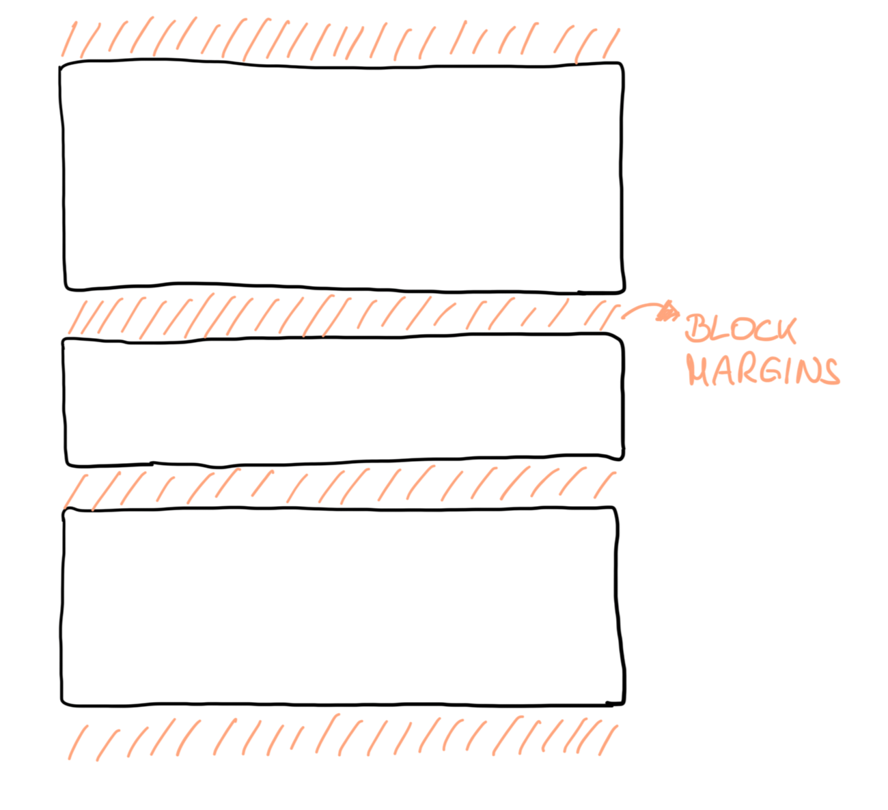
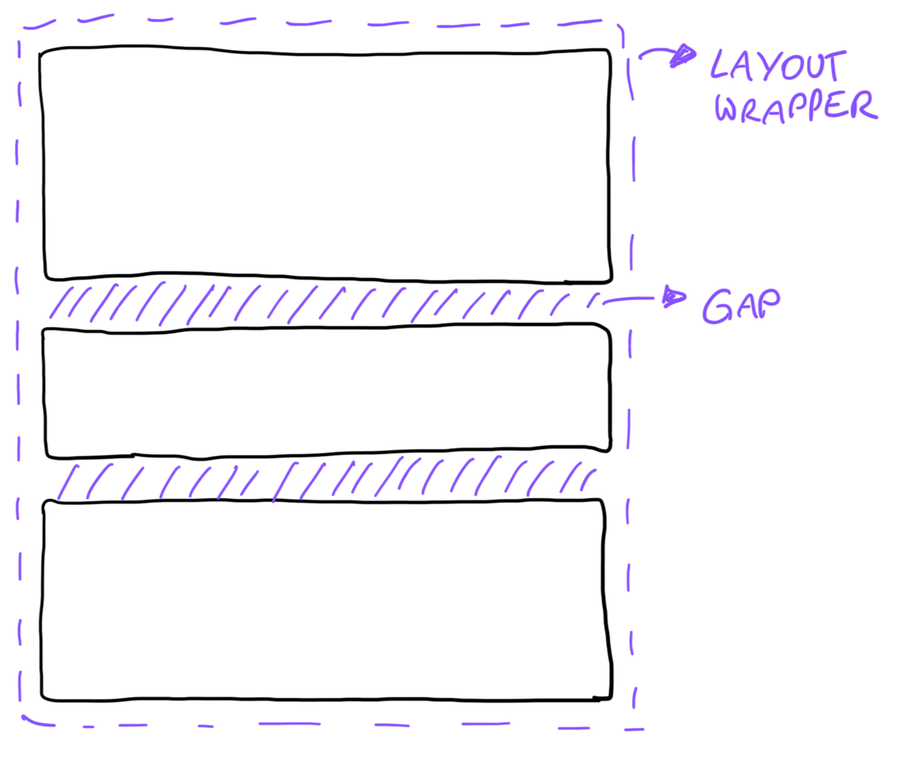
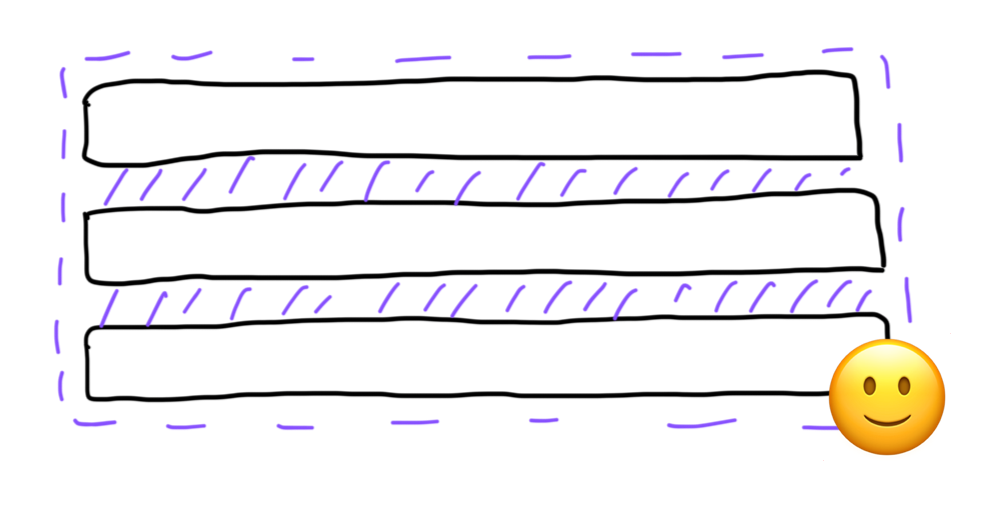
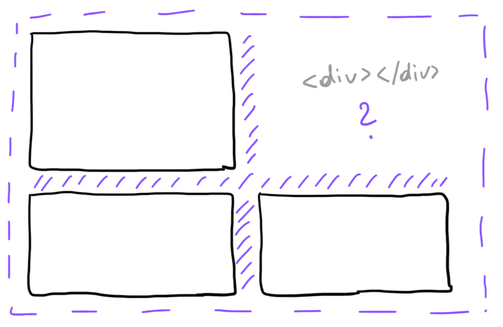
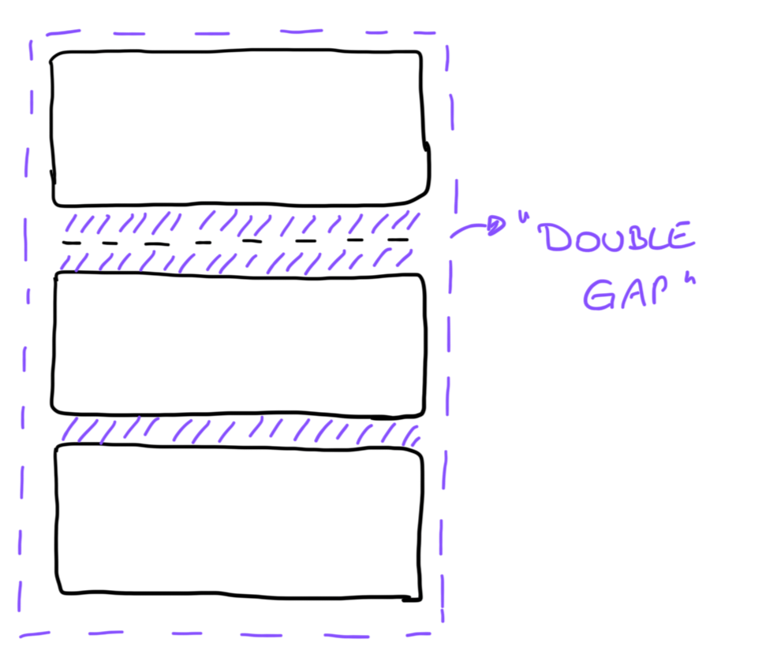

Working on different web projects with other developers from various backgrounds left me with the impression that it’s not always obvious to everyone how to structure HTML code in a way that lets CSS layouts work their magic. In a previous HTML advent calendar article I wrote about [how to get started with a web page’s HTML code based on a given wireframe](https://www.htmhell.dev/adventcalendar/2022/1/). This time, I’d like to go a bit further and talk about additional (non-semantic) markup required to build micro- and macro layouts.

Today I’d like to talk about when and where to open and close a `div` element, and why.

I’m going to show you three examples I picked from real projects built by real developers who had all the help they could possibly get: a design system including component documentation, code that has already been written and could be used as an example, and still… they made some tiny markup “mistakes” that lead to broken layouts (in production).

In a design system, there’s often documentation about individual components and building blocks, but not always about how to combine these elements and how to structure them. Often, there are multiple solutions to the same problem (some more elegant than others). Similar layouts might require completely different approaches. It’s not easy to write a documentation that covers every single layout problem that can come up.

In my experience, a “gut feeling” is often more helpful than rigid rules. Nevertheless, there is one guideline that I always follow when creating the markup for a specific layout: [the _law of proximity_ from the set of Gestalt principles](https://lawsofux.com/law-of-proximity/). Let’s dig into some examples to explain why!

## #1 Stacking elements vertically

The default behavior of block elements in HTML is the following: they are stacked in block direction (usually from top to bottom). By adding block margins to these elements, we get some space between them. The element itself controls its surrounding space. This is the default behavior in a browser for certain elements (e.g., headings, paragraphs, lists) as specified by user-agent styles.


Often when creating layouts, we think differently: we want to have a parent element that controls the layout within. This mindset became mainstream with the introduction of CSS flexible box (flexbox) or grid layouts.


Let’s say we work with a (vertical) stack component. We use it to create a consistent spacing between its child elements, for example, a stack of text content, cards or input elements:

```html
<my-vertical-stack spacing="large">
  <my-text-block />
  <my-card />
  <my-card />
  <my-card />
</my-vertical-stack>
```

```html
<my-vertical-stack spacing="medium">
  <my-text-input />
  <my-text-input />
  <my-text-input />
</my-vertical-stack>
```

In the above examples, there is no block margin defined for `<my-text-block>`, `<my-card>` or `<my-text-input>`. The `<my-vertical-stack>` wrapper component handles the spacing between these items.



As time goes by, new features are requested and the markup needs to change. In the first example, we need to extend the existing text by adding another text block on top. In the second one, validation messages should appear below the input fields. Someone changes the code as follows:

```html
<my-vertical-stack spacing="large">
  <my-text-block />
  <my-text-block />
  <my-card />
  <my-card />
  <my-card />
</my-vertical-stack>
```

```html
<my-vertical-stack spacing="medium">
  <my-text-input />
  <my-error-message />
  <my-text-input />
  <my-error-message />
  <my-text-input />
  <my-error-message />
</my-vertical-stack>
```

All requirements are met, great! Well… only the functional ones. We now have some layout issues here.

1. The two text blocks belong together, but they are now separated by the same spacing as the cards.
2. The error message belongs to the preceding input field, but there’s now the same amount of whitespace between inputs and messages in both block directions.


Let’s circle back to the law of proximity: elements that are related should be placed closer together.

To solve our layout issues, we need to introduce more markup to wrap the UI components that should be grouped visually.

```html
<my-vertical-stack spacing="large">
  <div>
    <my-text-block />
    <my-text-block />
  </div>
  <my-card />
  <my-card />
  <my-card />
</my-vertical-stack>
```

```html
<my-vertical-stack spacing="medium">
  <div>
    <my-text-input />
    <my-error-message />
  </div>
  <div>
    <my-text-input />
    <my-error-message />
  </div>
  <div>
    <my-text-input />
    <my-error-message />
  </div>
</my-vertical-stack>
```

The `<div>` could also be replaced by `<my-vertical-stack spacing="small">`, it really depends on the context; but you get the idea! Elements that are related and belong together often require a common parent element to create the desired layouts.


##  #2 Floating in a flex layout

Imagine a footer section in a dialog that contains a short summary text (e.g., a success or an error note) and a save button. The text should sit on the left, the button on the right. We need some space between. A little flex layout can help us out here.

```html
<div style="display: flex; justify-content: space-between;">
  <p>Some informative text.</p>
  <button type="submit">Save data</button>
</div>
```


A feature request comes in: we need to add an additional “Cancel” button. The result looks like this:

```html
<div style="display: flex; justify-content: space-between;">
  <p>Some informative text.</p>
  <button type="button">Cancel</button>
  <button type="submit">Save data</button>
</div>
```

From a functionality standpoint everything is fine; both buttons do what they should do after the update. Again, the problem is the resulting layout. On some screens everything looks nice and perfectly aligned.


When opening the modal on a larger viewport, however, the footer bar has more horizontal space, and depending on the length of the text, the “Cancel” button starts to float somewhere between the text and the “Save” button, with equal whitespace on both sides.


Again, we can think about the law of proximity: the buttons belong together, they are a group of possible actions, so we should give them a shared parent element to fix our layout problem here.

```html
<div style="display: flex; justify-content: space-between;">
  <p>Some informative text.</p>
  <div style="display: flex; gap: 8px;">
    <button type="button">Cancel</button>
    <button type="submit">Save data</button>
  </div>
</div>
```

There is one wrapping `div` now taking care of the buttons and the space between them and an outer wrapper that places the text and the action buttons group.


## #3 Conditionally rendered content

What I find quite often in code bases is the following:

```jsx
<my-layout-grid columns="2">
  <div><my-card><!-- content --></my-card></div>
  <div>
    {showDetails && (
      <my-card><!-- some detail content --></my-card>
    )}
  </div>
  <div><!-- more content --></div>
  <div><!-- even more content --></div>
</my-layout-grid>
```

The example code is inspired by JSX syntax. It describes a 2-column grid layout (using CSS grid behind the scenes) where the second card is only rendered when `showDetails` is `true`. The problem here is that the wrapping `div` element is rendered nonetheless. In case `showDetails` is `false`, the result in the output markup is an empty `div` as child element of the grid layout, which leads to an empty grid cell in the UI. This could be an intentional choice, though…



On smaller viewports, however, the layout changes to a one-column grid, and we’re left with a grid gap followed by an empty cell with `0px` height followed by another grid gap. Visually, there is now a double-gap between the first and the second content element, which can look slightly off.



Step one of my fix would be to move the second `div` element into the conditionally rendered block to fix the spacing issue.

```html
{showDetails && (
  <div>
    <my-card><!-- some detail content --></my-card>
  </div>
)}
```

To achieve the goal of the third `div` always starting in its own row, no matter if the detail content card is shown or not, multiple solutions come to my mind.

We could tell this specific `div` element to do exactly that (always start in a new row) by adding the following style: `<div style="grid-column: 1">`.

We could add a wrapping `div` around the first two cards, because they somehow belong together (general content and detail content), and create its own micro-layout inside while stretching the wrapping `div` horizontally to always occupy the full grid width:

```html
<my-layout-grid columns="2">
  <div style="grid-column: 1 / -1; display: grid; grid-template-columns: subgrid;">
    <div><my-card><!-- content --></my-card></div>
    <div>
      {showDetails && (
        <my-card><!-- some detail content --></my-card>
      )}
    </div>
  </div>
  <!-- more content -->
</my-layout-grid>
```

We could build two individual sections right from the start. We don’t necessarily need to put everything into a single grid wrapper if this complicates things. Remember to add space between the two grid sections:

```html
<my-vertical-stack spacing="medium">
  <my-layout-grid columns="2">
    <div><my-card><!-- content --></my-card></div>
    <div>
      {showDetails && (
        <my-card><!-- some detail content --></my-card>
      )}
    </div>
  </my-layout-grid>

  <my-layout-grid columns="2">
    <div><!-- more content --></div>
    <div><!-- even more content --></div>
  </my-layout-grid>
</my-vertical-stack>
```

The best solution depends—as always—on the context. Often in larger applications, the markup on a page is more complicated than in the example(s) above, with even more conditionally rendered blocks and dependencies between elements. There is no right or wrong solution, but maybe one that is more resilient to future updates and code changes; one that describes within the markup how the individual elements and components are related and as such convey semantic meaning (for the developer) without actually using dedicated semantic HTML elements.

## What to take away

Not everyone who writes HTML code or pieces together a user interface with given components from a UI library knows the CSS layouts algorithms that come with them. This is fine!

It takes experienced frontend developers or designers who can spot a small difference in spacing at first glance, who look at the screen and in their minds draw boxes around related elements, who randomly resize the browser viewport and see how the layout adjusts…

Not every little layout sophistication can be documented in a design system. As with other aspects in software development (and life), these skills can be improved with practice.

Most questions about layout in web design can be answered, or at least simplified, when thinking not only in individual boxes but in groups. Always remember the “law of proximity” and how it can be translated to building HTML code: elements that are related (and thus belong together) often require a common parent element—which can just be as simple as a `div`—to let CSS reach its full potential. ✨
