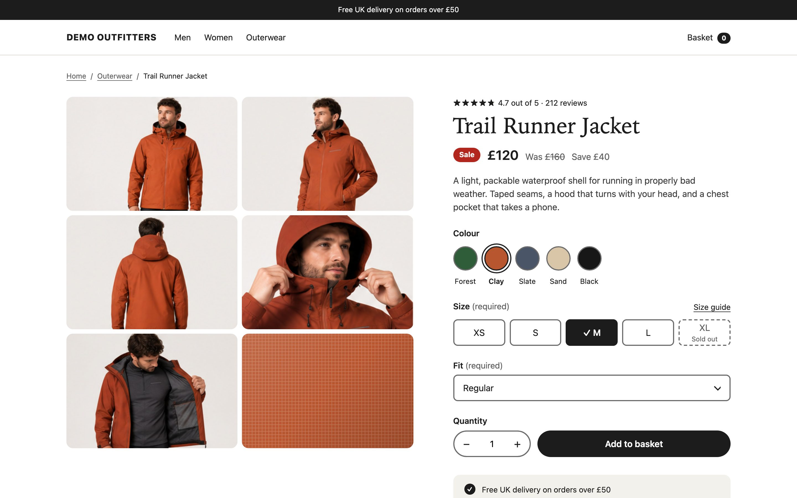
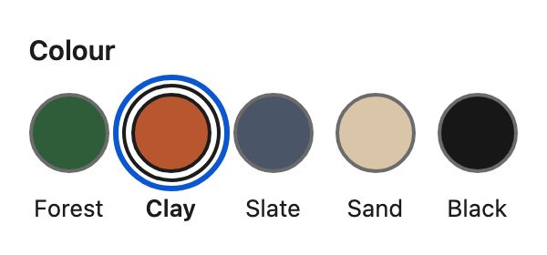
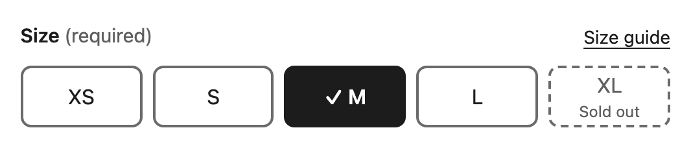
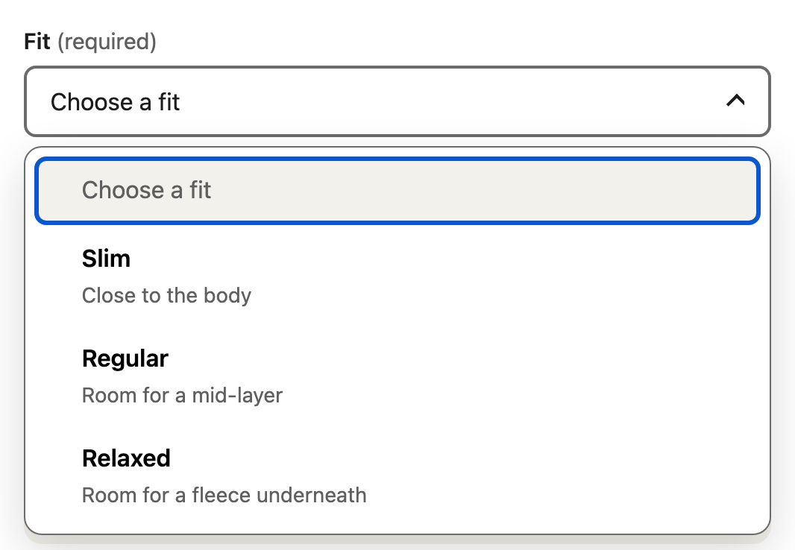
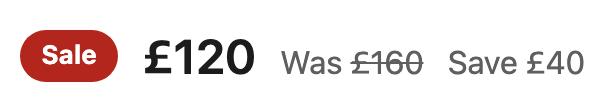

<!-- prettier-ignore-start -->

If you dive deep into the source of many modern product pages, you'll see colour swatches and size pickers built from `<div>`s, and quantity steppers made from buttons without accessible names. Unfortunately, the narrative tends to be: the designer didn't want a native control, so someone built one that matched. ***We're developers, we're smart, we can build it!*** But when recreating native form controls from scratch how many of us are then testing them for full browser functionality and accessibility?

This year I tested 59,400 product pages from Shopify and WooCommerce stores ranked in the top million websites for the [State of Ecommerce Accessibility report 2026](https://davedavies.dev/state-of-ecommerce-accessibility/). 64% had at least one accessibility issue that axe-core rates as critical. Plenty of those failures sit in the product form, and many of those form controls are essential in order to choose options and buy. Automated testing isn't the only way to test a page, but it's a good place to start. 

It doesn't have to be this way. A product page can look great and still be accessible. Native form controls, styled with modern CSS, can match a Figma design almost perfectly, and native controls bring keyboard support, focus handling and the correct semantics with them for free. Here I'll rebuild the parts of a product page that seem to most often go wrong.



## Colour swatches are really just radio buttons

Choosing a colour is a single choice from a group, which is what radio buttons are for. Wrap each one in a `<label>` with its colour name, and put the group in a `<fieldset>` with a `<legend>`:

```html
<fieldset>
  <legend>Colour</legend>
  <label class="swatch">
    <input type="radio" name="colour" value="Forest" style="--swatch: #2f5d3a" checked>
    Forest
  </label>
  <label class="swatch">
    <input type="radio" name="colour" value="Clay" style="--swatch: #b8562f">
    Clay
  </label>
  <!-- Slate, Sand and Black follow the same pattern -->
</fieldset>
```

Style the radio itself rather than hiding it. `appearance: none` removes the default circle but keeps the element, so focus, checked states, arrow keys, `required` and form submission all keep working without JavaScript:

```css
.swatch input {
  appearance: none;
  margin: 0;
  inline-size: 2.75rem;
  block-size: 2.75rem;
  border: 2px solid var(--line);
  border-radius: 50%;
  background: var(--swatch);
}

.swatch input:checked {
  border-color: var(--ink);
  box-shadow: 0 0 0 3px var(--bg), 0 0 0 5px var(--ink);
}

.swatch:has(:checked) {
  font-weight: 600;
}
```

The selected swatch gets a dark ring and its name goes bold, so the state doesn't rely on colour alone. This is where `:has()` earns its keep: the colour name is a bare text node, so there's no element after the input to select. The borders are 5.3:1 against the page, above WCAG's 3:1 for non-text contrast, so even the palest swatch has a clear edge. I kept the colour names visible because they help everyone.

Every form control shares one focus style, a blue outline at 6.4:1 against the page. The swatch's outline gets a bigger offset so it clears the checked ring:

```css
:focus-visible {
  outline: 3px solid var(--focus);
  outline-offset: 3px;
}

.swatch input:focus-visible {
  outline-offset: 7px; /* clear the checked ring */
}
```



## Size options

Sizes use the same pattern. This time the input becomes the background of each option and the size sits on top:

```html
<fieldset class="sizes">
  <legend>Size <span class="required">(required)</span></legend>
  <label class="pill"><input type="radio" name="size" value="XS" required><span>XS</span></label>
  <label class="pill"><input type="radio" name="size" value="M"><span>M</span></label>
  <label class="pill"><input type="radio" name="size" value="XL" data-sold-out><span>XL <small>Sold out</small></span></label>
  <!-- S and L follow the same pattern -->
</fieldset>
```

Here a sibling combinator does the job, so there's no need for `:has()`:

```css
/* .pill and its span are both position: relative */
.pill input {
  appearance: none;
  position: absolute;
  inset: 0;
  inline-size: 100%;
  block-size: 100%;
  margin: 0;
  border: 2px solid var(--line);
  border-radius: .5rem;
}

.pill input:checked {
  background: var(--ink);
  border-color: var(--ink);
}

.pill input:checked + span {
  color: var(--bg);
}

.pill input:checked + span::before {
  content: "✓" / "";
  margin-inline-end: .25em;
}
```

The tick is generated content with empty alternative text, `"✓" / ""`, so it's seen but not announced. That syntax has been Baseline since July 2024.




## Custom dropdowns

Developers often build custom dropdowns from scratch, because historically a native `<select>` was very difficult to style well, and couldn't hold a second line of text or an icon.

Bleeding edge customizable `<select>` elements change that for good. Opt in with `appearance: base-select` and the `<select>`'s button and option list become stylable, with real markup inside each option. Magical! It's still a `<select>` at heart, so the label, keyboard support, form submission and `required` all come with it for free:

```html
<div class="field fit">
  <label for="fit">Fit <span class="required">(required)</span></label>
  <select id="fit" name="fit" required>
    <button><selectedcontent></selectedcontent></button>
    <option value="">Choose a fit</option>
    <option value="Slim"><span class="fit__name">Slim</span><span class="visually-hidden">, </span><span class="fit__desc">close to the body</span></option>
    <!-- Regular and Relaxed follow the same pattern -->
  </select>
</div>
```

The hidden comma uses the usual `visually-hidden` class, which keeps text in the accessibility tree without showing it:

```css
.visually-hidden {
  position: absolute;
  inline-size: 1px;
  block-size: 1px;
  overflow: hidden;
  clip-path: inset(50%);
  white-space: nowrap;
}
```

```css
@supports (appearance: base-select) {
  .fit select,
  .fit select::picker(select) {
    appearance: base-select;
  }

  /* The closed select shows the name only */
  .fit selectedcontent :not(.fit__name) {
    display: none;
  }
}
```



<p class="highlight"><strong>Browser support:</strong> customizable select shipped in Chrome and Edge 135 and in Safari 27. Firefox has only a partial version behind flags, so it isn't Baseline yet. The rules sit inside <code>@supports</code>, so other browsers get an ordinary select, and the hidden comma means its options still read "Slim, close to the body".</p>

There's two very important caveats to note: Each option's accessible name is ***all of its text***, description included, so keep descriptions short and useful. And browser vendors currently disagree on the closed select's value: Chromium exposes "Regular", but WebKit builds it from the option's full text, so it's a very good idea to test it yourself.

## Quantity

A quantity field with no usable label was the most common failure in the audit, on 8.7% of pages: the word "Quantity" was on screen, but often in a plain `<div>` rather than a `<label>` linked to the form element. A quantity is a number, so use a number field with a label and a minimum:

```html
<label for="qty">Quantity</label>
<input id="qty" name="quantity" type="number" inputmode="numeric" min="1" value="1" required>
```

If the design insists on minus and plus buttons, add them with a short script: name them "Decrease quantity" and "Increase quantity", use `stepUp()` and `stepDown()` so `min` is respected, set an empty or too-low value back to `min`, and announce the new value. Without the script, the number field still works.

## The price

A sale price needs two prices and something that says which is which:

```html
<p class="price">
  <span class="price__badge">Sale</span>
  <span class="price__now">£120</span>
  <span class="price__was">Was <s>£160</s></span>
  <span class="price__save">Save £40</span>
</p>
```



`<s>` is the right element for a price that's no longer accurate, but no screen reader says "was". In [Adrian Roselli's 2025 tests](https://adrianroselli.com/2025/04/tweaking-text-level-styles-reprised.html), NVDA said "deleted", JAWS and VoiceOver said "deletion", and some said nothing at all. So the word "Was" has to be on the page, where it also helps anyone who can't see the strikethrough. Before macOS 26, VoiceOver's read-all mode could also skip text before an `<s>` in the same paragraph.

## Does all this work in every browser?

No. Not everything here is Baseline yet, and that's fine as long as each feature is an enhancement. These are the main features the demo uses, and what happens without them:

| Feature                                                                    | Support in October 2026                        | Without it                                                   |
| -------------------------------------------------------------------------- | ---------------------------------------------- | ------------------------------------------------------------ |
| `appearance: none`, `:has()`, `:focus-visible`, `<dialog>`, forced colours | Baseline, widely available                     | No fallback needed                                           |
| `<details name>`, one accordion section open at a time                     | Baseline, newly available (September 2024)     | Sections open independently                                  |
| Invoker commands, `command` and `commandfor`                               | Baseline, newly available (December 2025)      | A nine-line script opens the dialog                          |
| `closedby="any"` on the dialog                                             | Chrome 134 and Firefox 141, not Safari         | Clicking outside doesn't close it; Escape and Close still do |
| Customizable select                                                        | Chrome and Edge 135 and Safari 27, not Firefox | An ordinary `<select>`                                       |
| `interpolate-size`                                                         | Chrome and Edge only                           | The accordions open without animating                        |

My rule of thumb: check the feature's [Baseline](https://web.dev/baseline) status, make sure the page still works without it, and wrap the enhancement in `@supports` where you can. Then test in a browser that doesn't have it. Support moves quickly, too: Safari 27 added customizable select in September 2026.

## This isn't an exhaustive list

A product page has plenty more to get wrong: image carousels and zoom, reviews and star ratings, delivery estimators, sticky add-to-basket bars, quick-add buttons on product cards, and prices that change with the variant. The demo in codepen has a few extra examples, but each could be an article of its own. Wherever you can, start with the HTML element that already does the job, then style it.

## Keep testing

Browsers keep shipping changes to these features, so testing isn't a one-off before launch. Make it part of every release. Try the whole page, and read its code, in [the product page demo on CodePen](https://codepen.io/thedavedavies/pen/azJavpY).

<p class="codepen" data-height="600" data-default-tab="result" data-slug-hash="azJavpY" data-pen-title="An accessible product page that still looks good" data-user="thedavedavies" style="height: 600px; box-sizing: border-box; display: flex; align-items: center; justify-content: center; border: 2px solid; margin: 1em 0; padding: 1em;">
<span>See the Pen <a href="https://codepen.io/thedavedavies/pen/azJavpY">
An accessible product page that still looks good</a> by Dave Davies (<a href="https://codepen.io/thedavedavies">@thedavedavies</a>)
on <a href="https://codepen.io">CodePen</a>.</span>
</p>

## Further reading

- [State of Ecommerce Accessibility 2026](https://davedavies.dev/state-of-ecommerce-accessibility/)
- [Customizable select elements](https://developer.mozilla.org/en-US/docs/Learn_web_development/Extensions/Forms/Customizable_select) on MDN
- [The golden rule of customizable select](https://webkit.org/blog/18117/the-golden-rule-of-customizable-select/) from WebKit
- [Tweaking text level styles, reprised](https://adrianroselli.com/2025/04/tweaking-text-level-styles-reprised.html) by Adrian Roselli

<!-- prettier-ignore-end -->

<script async src="https://public.codepenassets.com/embed/index.js"></script>
