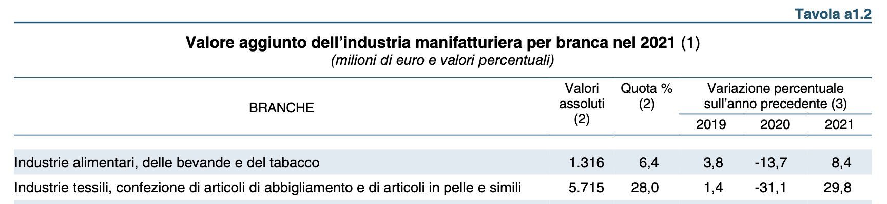
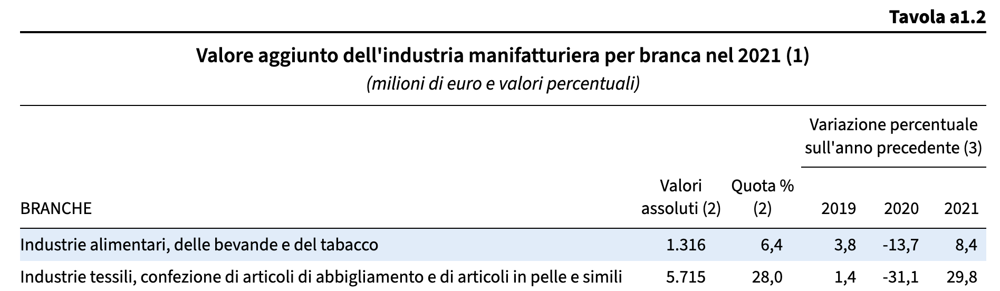
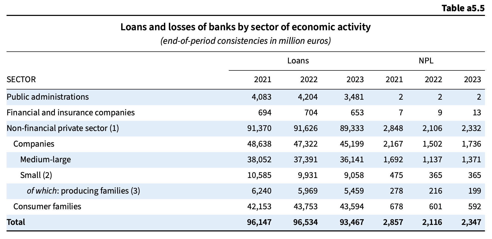
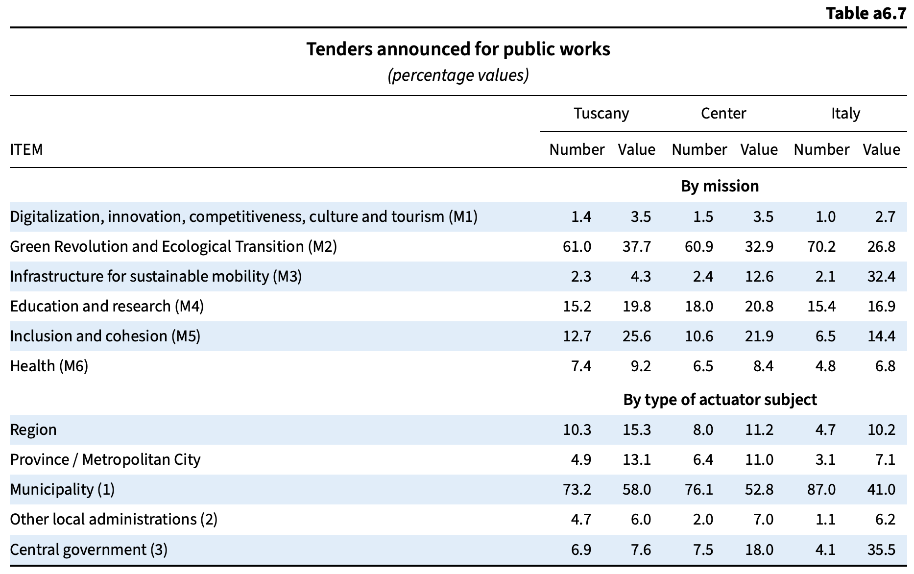
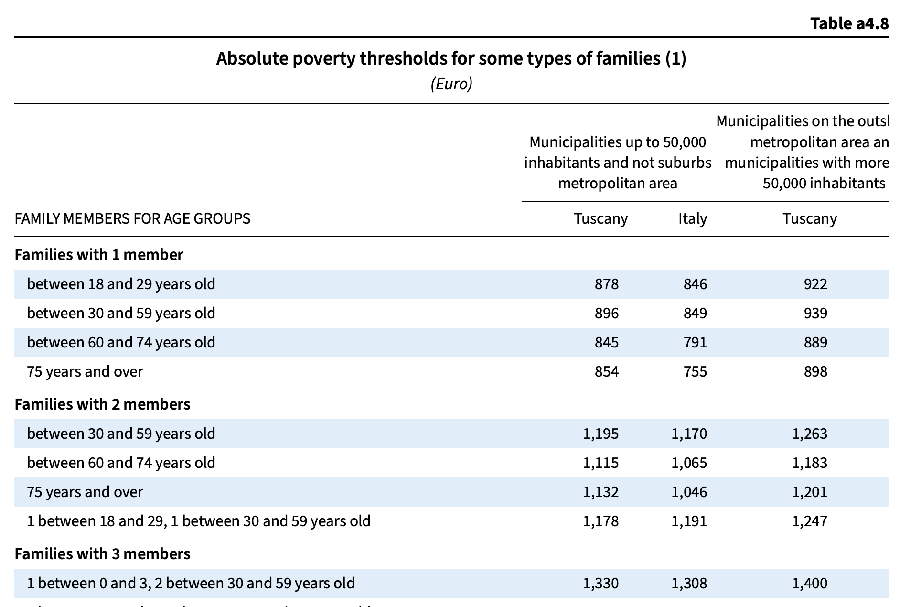
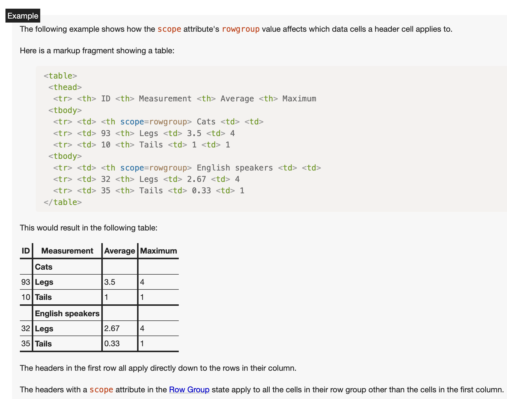

Is it feasible to write complex numerical tables in HTML that are compatible with screen readers whilst preserving their distinctive visual presentation?

The majority of complex numerical tables can be rendered accessible through the integration of semantic HTML with server-side and client-side processing via JavaScript.

## What are numerical tables?

A numerical table is a table used for displaying quantitative data (aka numbers).

Numerical tables are common in accounting, finance, official government reports, and academic papers.

They display complex visual layouts, and because these are hard to accommodate within responsive pages they rarely appear in HTML.

They are also known for being hard, if not impossible, to code for accessibility.

This is unfortunate because in many instances they remain the sole method used for conveying essential information and statistics.

## Simple and complex numerical tables

We define a simple numerical table as a table that has one header row (the first row) and one header column (the first column) and that contains a single unlabelled group of data rows. In simple numerical tables the data rows are flat. Which means that there are no hierarchical relationships between them. 

Complex numerical tables are conversely tables that present **one or more** of the following features:

- Column headers organised over multiple rows (hierarchical column headers)
- Hierarchical relationships within data rows (hierarchical row headers) 
- Data rows organised in multiple groups, each with its own label

Coding simple numerical tables in HTML is relatively simple:
they fall within what W3C calls [Tables with Two Headers](https://www.w3.org/WAI/tutorials/tables/two-headers/). 

With respect to accessibility what matters in simple numerical tables is coding their header cells using `th` elements with the correct scope attribute value set. Which is `scope=col` for column headers and `scope=row` for row headers. 

After having done that, when navigating the table using the screen reader commands for bidirectional table navigation (Ctrl+Alt+Arrow keys when using NVDA or JAWS), data cells values are announced together with the corresponding headers text. 

Which is what is needed for meaningfully consuming the data, as can be observed in this “[Using NVDA with tables](https://youtu.be/d-MBaU5d4Pk?si=lhNpDJ6fUuA4zsB6)” YouTube video by Popetech.

Coding complex numerical tables for accessibility is not that straightforward though.

Support for columns headers organised over multiple rows (hierarchical column headers) is present in the latest versions (2026) of NVDA and JAWS, including support for header cells spanning multiple rows. But not every screen reader user relies on the newest releases of NVDA or JAWS.

Support for `th` elements having `scope=rowgroup` for labelling `tbody` elements is scarce. Even when it is supported, it is not announced as expected when the `th` element is positioned in `colspan` across the top of the row group, as is typical in numerical tables.

Finally, the [HTML standard](https://html.spec.whatwg.org/#tables) lacks guidance on encoding hierarchical relationships between rows in ordinary tables. As a result, screen readers offer no built-in support for hierarchical row headers in numerical tables.

How should we ensure, then, that complex numerical tables coded in HTML are accessible to users relying on screen readers?

## Setting up a strategy for screen reader accessibility of complex numerical tables

The first thing to consider is how a screen reader should behave when processing these tables, especially when reading numerical cell values.

It is worth noting that screen readers do not announce table structures, and that is what non-sighted users are accustomed to. Table headers - that is `th` elements - are not announced (though you can set up JAWS to use a different voice when reading them). Likewise, entering and exiting `tbody`, `tfoot` and `thead` elements is not announced nor there are commands to enumerate them or jump to their beginning and end. 

Even with complex tables, therefore, reading a numerical cell requires hearing the matching header text together with the value.

Thus, the first issue to address is: what constitutes meaningful text for hierarchical headers in complex tables?

For column headers arranged hierarchically, the answer is clear: it is the text formed by joining the full hierarchy. Recent versions (2026) of JAWS and NVDA follow this approach.

For rows organised hierarchically, the solution must be consistent. Irrespective of whether the hierarchy is presented via indentation or alternative layouts, a mechanism must be provided for screen readers to read the combined hierarchy of row headers.

Lastly, labels for groups of rows should be read as table captions are. That is their text together with something that alerts the user that they are not ordinary cell values nor row or column headers. And they should be announced only once, when entering the group of rows.

Readers wishing to review the solutions outlined in this post may access the full statistical appendix of an economy report converted into HTML at the following address:

[https://renatomancuso.com/htmhell2026/](https://renatomancuso.com/htmhell2026/)

Let us examine each case individually.
 
## Making hierarchical column headers accessible

If you are targeting the latest versions (2026) of NVDA and JAWS, coding the table header using semantic HTML is all that is needed to make hierarchical column headers accessible.

Wrap the headers rows in a `thead` element, use `th` elements for the header cells setting their `scope` attribute to `col`, and use the `colspan` and `rowspan` attributes for header cells spanning multiple columns and rows.

In a few years, this approach will probably be sufficient for coding accessible hierarchical column headers. However, if you wish to support other screen readers or older versions of NVDA and JAWS right now, you must convert this semantic HTML code into an alternative form.

There are two principal reasons.

First, header cells that span multiple rows can confuse screen readers, leading data cells to be linked with the wrong header cells.

Second, data cells are linked only to the column header in the final, bottom-most table header row; ancestors are disregarded.

To overcome these limitations we must therefore: 
- avoid using header cells spanning multiple rows
-	make sure the final header row at the base includes a non-empty column header cell for every table column

Avoiding header cells spanning multiple rows is straightforward: add as many cells in the rows below as needed and remove the `rowspan` attribute from the original cell. The header text must then be moved to the generated bottom-most header cell to prevent empty column header cells in the last header row.

This is somewhat inconvenient because complex numerical tables designed for printing are usually organised from top to bottom. 

The two figures below illustrate the contrast in visual layout between the original table set in a PDF and its HTML counterpart.

<figure>

<figcaption>Hierarchical column headers (original PDF)</figcaption>
</figure>
 
<figure>

<figcaption>Hierarchical column headers (HTML version)</figcaption>
</figure>

Even if the headers visual alignment differs in the HTML version, sighted users interpret them in the same way though.

The next step is to silence all headers rows **but the bottom-most one** by marking them with `aria-hidden="true"` and prepend the ancestors header text in each of the headers cells of the bottom-most header row, by injecting it into a `div` element hidden from sighted users. 

From the screen reader’s viewpoint, the table header now consists of one row, and reading the data cells produces a header announcement corresponding to what is achieved by concatenating the full hierarchy of the relevant column headers.

This time, though, concatenating the headers text did not depend on the user screen reader capabilities.

To summarise, we can code the above table header using semantic HTML as follows:

```html
<table>
  <thead>
     <tr>
        <th scope="col" rowspan="2">BRANCH</th>
        <th scope="col" rowspan="2">Absolute values</th>
        <th scope="col" rowspan="2">Share %</th>
        <th scope="col" colspan="3">
	        Percentage change over the previous year
        </th>
     </tr>
     <tr>
        <th scope="col">2019</th>
        <th scope="col">2020</th>
        <th scope="col">2021</th>    
     </tr>
  </thead>
  <tbody>
     <!-- rows removed -->
  </tbody>   
</table>
```

If we aim to support all screen readers, we must first transform it this way (step 1):

```html
<table>
  <thead>
     <tr>
        <th></th>
        <th></th>
        <th></th>
        <th scope="col" colspan="3">
	        Percentage change over the previous year
        </th>
     </tr>
     <tr>
        <th scope="col">BRANCH</th>
        <th scope="col">Absolute values</th>
        <th scope="col">Share %</th>
        <th scope="col">2019</th>
        <th scope="col">2020</th>
        <th scope="col">2021</th>    
     </tr>
  </thead>
  <tbody>
     <!-- rows removed -->
  </tbody>   
</table>
```

Finally, this is how we must further transform it to make screen readers announce the full hierarchy of column headers text while reading the corresponding data cells (step 2):

```html
<table>
  <thead>
     <tr aria-hidden="true">
        <th></th>
        <th></th>
        <th></th>
        <th scope="col" colspan="3">
	        Percentage change over the previous year
        </th>
     </tr>
     <tr>
        <th scope="col">BRANCH</th>
        <th scope="col">Absolute values</th>
        <th scope="col">Share %</th>
        <th scope="col">
           <div class="visually-hidden">
              Percentage change over the previous year
           </div>
           2019
        </th>
        <th scope="col">
           <div class="visually-hidden">
              Percentage change over the previous year
           </div>
           2020
        </th>
        <th scope="col">
           <div class="visually-hidden">
              Percentage change over the previous year
           </div>
           2021
        </th>    
     </tr>
  </thead>
  <tbody>
     <!-- rows removed -->
  </tbody>   
</table>
```

Before moving to the next case, let’s answer one question: should we do this processing server side or should we do it client side when the page is loaded in the client browser?

I personally prefer doing it partly server side (the HTML rewrite) and partly client side (injecting the ancestors text in the bottom-most header cell). The reason being that native support for complex numerical tables will eventually appear in all screen readers. And when this will happen the only thing required will be to remove the calls to the JavaScript code doing the processing.

## Making hierarchical relationships between data rows accessible

Let’s now examine the case of hierarchical relationships between data rows. 

These relationships are frequently — though not invariably —shown by indenting the related row headers, as illustrated in the figure below:

<figure>

<figcaption>Hierarchical relationships between data rows represented by visual indentation</figcaption>
</figure>

Translating these layouts to HTML involves two separate issues. 

The first is visual. In non-web documents, indentation comes from inserting spaces before the header text. This fails during HTML conversion because leading spaces are normally removed during rendering, so the indentation disappears.

The second issue concerns accessibility. Even if we compel the display of these blank characters, an accessibility problem would arise because the parent–son relationship would be conveyed solely through presentation.

To create visual indentation for headers in the HTML version, we might use padding instead. We can apply a custom attribute on the matching row element to show the desired indent level, taking an integer for that amount.

If we choose to name this attribute `data-indent-level`, these are the declarations we might apply within our CSS:

```css
table.numerical tbody {

    tr[data-indent-level="1"] th:first-child {
        padding-left: .75rem;
    }

    tr[data-indent-level="2"] th:first-child {
        padding-left: 1.5rem;
    }

    tr[data-indent-level="3"] th:first-child {
        padding-left: 2.25rem;
    }

    tr[data-indent-level="4"] th:first-child {
        padding-left: 3rem;
    }

    tr[data-indent-level="5"] th:first-child {
        padding-left: 3.75rem;
    }

    tr[data-indent-level="6"] th:first-child {
        padding-left: 4.5rem;
    }

}
```

Although we applied the attribute to indent headers visually, noting the row’s indentation level means the hierarchy can now be determined programmatically.

This is because the parent of a line with a `data-indent-level` greater than zero is the first line we encounter, scrolling backwards the list of rows of the same `tbody` element, whose `data-indent-level` attribute has a lower value than that of the starting row (or where the data-indent-level attribute is missing).

We can now expose the hierarchy to screen readers by rewriting the row headers text, following the same method applied to hierarchical column headers.

To understand why this step is necessary, imagine what is heard when the process is skipped. Suppose we use a screen reader to scan the data cells in the second column. When moving from the third to the fourth data row, we need the screen reader to state “Non-financial private sector, Companies” rather than only “Companies”. Without hearing the parent row header, users cannot tell that “Companies” is a subcategory of “Non-financial private sector”.

For the same reason, when we reach the data cell in the eighth row, we must hear “Non-financial private sector, Consumer families” rather than just “Consumer families”. Otherwise, it is hard to see that “Consumer families” directly follows “Non-financial private sector” five lines above, and that it is not a sibling of the preceding row labelled “of which: producing families”.

To summarise, we code the row headers of the table above as follows:

```html
	<tbody>
		<!-- initial rows removed -->
		<tr>
		  <th scope="row">Non-financial private sector</th>
		</tr>
		<tr data-indent-level="1">
			<th scope="row">Companies</th>
		</tr>
		<tr data-indent-level="2">
			<th scope="row">Medium-large</th>
		</tr>
		<tr data-indent-level="2">
			<th scope="row">Small</th>
		</tr>
		<tr data-indent-level="3">
			<th scope="row">of which: producing families</th>
		</tr>
		<tr data-indent-level="1">
			<th scope="row">Consumer families</th>
		</tr>
		<!-- final rows removed -->
	</tbody>
```

We need to reshape this into the following form:

```html
	<tbody>
		<!-- initial rows removed -->
		<tr>
		  <th scope="row">Non-financial private sector</th>
		</tr>
		<tr data-indent-level="1">
			<th scope="row">
			   <div class="visually-hidden">
				   Non-financial private sector,
			   </div>
			   Companies
		   </th>
		</tr>
		<tr data-indent-level="2">
			<th scope="row">
			   <div class="visually-hidden">
				   Non-financial private sector, Companies,
			   </div>
				Medium-large
			</th>
		</tr>
		<tr data-indent-level="2">
			<th scope="row">
			   <div class="visually-hidden">
				   Non-financial private sector, Companies,
			   </div>
				Small
			</th>
		</tr>
		<tr data-indent-level="3">
			<th scope="row">
			   <div class="visually-hidden">
				   Non-financial private sector, Companies, Small,
			   </div>
			   of which: producing families
			</th>
		</tr>
		<tr data-indent-level="1">
			<th scope="row">
			   <div class="visually-hidden">
				   Non-financial private sector,
			   </div>
				Consumer families
			</th>
		</tr>
		<!-- final rows removed -->
	</tbody>
```

Why not use `aria-level` or the `id` and `headers` attributes?

`aria-level` behaviour deviates from our intent, since we seek to replicate how data cells are read in simple tables extended to complex ones.

By using `id` and `headers` we can achieve something close to what we want. But we would have to use the `id` and `header` solution for all row and column headers and for each data cell. Which means that writing and maintaining the HTML table code would be a nightmare. Furthermore, not all screen readers support `id` and `headers` or handle them in the same way.

## Handling multiple group of rows and row groups labels

In complex numerical tables, rows are often arranged in multiple groups, with each group introduced by a distinct label. The following figure shows an example:

<figure>

<figcaption>Complex numerical table with two groups of rows and group labels - “By Mission”, and “By type of actuator subject” - centred above data cells</figcaption>
</figure>

Centring the label of the group above the data cells is not the only choice. For example, the label could align left while the data rows are indented. Or, the label might align left and have a bold weight while the data rows are unindented and normal weight. One way to separate these later cases from genuine hierarchical headers is the lack of non-empty data cells in the row.

<figure>

<figcaption>Example of group labels left aligned with indented data rows</figcaption>
</figure>

The HTML Standard covers tables with multiple row groups (multiple `tbody` elements) and describes how to code [headers aligned with those groups](https://html.spec.whatwg.org/multipage/tables.html#the-th-element).

<figure>

<figcaption>Definition and example of <code>th</code> elements having <code>scope=rowgroup</code></figcaption>
</figure>

Unfortunately, current support for `th` elements with `scope=rowgroup` placed in `colspan` above the data rows is inconsistent across products. 

Furthermore, apart from the most recent versions (2026) of NVDA, the observed behaviour differs from our goal: group labels should be announced only once upon entering the corresponding row group.

Which seems to be what every screen reader does when it instead reads a data cell spanning the whole row. 

Consequently, as screen reader users are accustomed to not be alerted of table structural elements, a practical but likely disputed approach to meet our goal would be to code the label as a `td` element rather than as a `th` element. 

Alternatively, to better align with our strategy to use semantic HTML, we can code the label as a `th` element with `scope=rowgroup` and convert it to a `td` element once the page loads in the user’s browser.

The initial code would therefore be this:

```html
   <table>
	   <thead>
		   <!-- table header rows removed -->
	   </thead>

	   <tbody>
		   <tr>
			   <th scope="rowgroup" colspan="7">
				   By mission
			   </th>
		   </tr>
		   <!-- data rows removed -->
	   </tbody>

	   <tbody>
		   <tr>
			   <th scope="rowgroup" colspan="7">
				   By type of actuator subject
			   </th>
		   </tr>
		   <!-- data rows removed -->
	   </tbody>

   </table>
```

And this is what it must be transformed into:

```html
   <table>
	   <thead>
		   <!-- table header rows removed -->
	   </thead>

	   <tbody>
		   <tr>
			   <td colspan="7">
				   By mission
			   </td>
		   </tr>
		   <!-- data rows removed -->
	   </tbody>

	   <tbody>
		   <tr>
			   <td colspan="7">
				   By type of actuator subject
			   </td>
		   </tr>
		   <!-- data rows removed -->
	   </tbody>

   </table>
```

This approach works only for row groups that are not nested. When row groups are nested — and some authors do arrange them this way — a practical alternative is to handle the group labels as in the hierarchical row headers scenario.


## Handling numerical ranges and missing values

The occurrences discussed in this last section are not limited to tables, though they arise often in numerical tables. Therefore managing them correctly matters for the general accessibility of such tables.

When writing numerical ranges, avoid shortening them. Screen readers interpret 2021–2022 correctly, whereas 2021–22 may be read as ‘2021 minus 22’.

Missing values should be stated explicitly. Economics and statistics papers often sort them into distinct categories, each expressed in a different manner.

For example:

| representation | meaning |
|:--|:--|
| – | the phenomenon does not exist |
| .... | the phenomenon exists but its value is not known |
| .. | the value is nil or less than half the final digit shown |
| :: | not statistically significant |
| () | provisional |

As screen readers generally omit punctuation, hidden text should be employed to enhance each instance. For example, when ‘–’ appears as a data cell value, enclose the value in a `span` with `aria-hidden="true"` and add a hidden `div` so that the cell is read as ‘the phenomenon does not exist’.

## Further reading

- [Penn State University - Tables](https://accessibility.psu.edu/tables/)
- [HTML Living Standard - Tabular data](https://html.spec.whatwg.org/multipage/tables.html#header-and-data-cell-semantics)
- [Tables with Two Headers (part of WAI Table Tutorials)](https://www.w3.org/WAI/tutorials/tables/two-headers/)
- [Design Better Data Tables](https://medium.com/mission-log/design-better-data-tables-430a30a00d8c)
