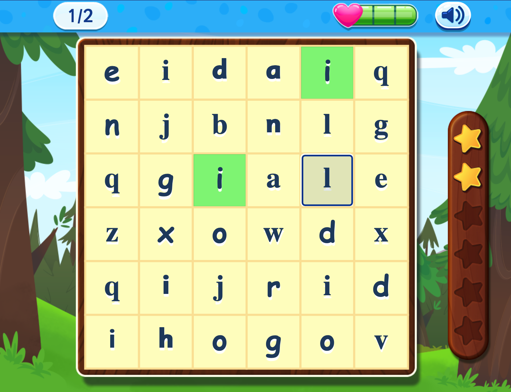
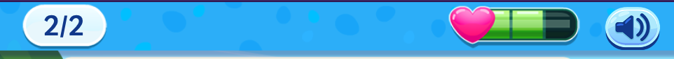
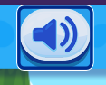
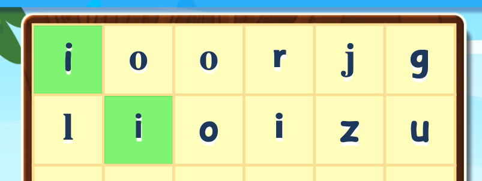
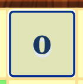
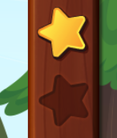

## Canvas, the Good, the Bad and the Inaccessible
If you’re a parent (or primary school teacher) you’re probably familiar with Readingeggs. A colourful, engaging learning to read program with ants that sing and dance. Activities range from tapping the correct letter, matching words with their pictures, reading books and answering quiz questions.

Back when it was being developed it was using Flash, which supported that fun, interactive mix of animations and activities. With the death of Flash they got converted into Canvas, an HTML element that can support this functionality. With it you are free to draw, add images, animations, sound effects and interactive elements.

Canvas elements however, are not accessible to keyboards and screen readers. It is treated as a blank image and generally was used to draw pictures and diagrams on the web. You can add some basic description in similar way as alt text, but that just wasn’t going to cut it for such detailed activities.

## The Fallback

We researched and discovered that Canvas elements are designed to have fallback HTML in case they don’t load (e.g. IE 6) which can be harnessed for accessibility. By having fallback HTML the screen reader can read out what’s on the screen. Interactive elements, such as links and buttons, can also be linked to images and text on the Canvas with JavaScript, to mimic that interactivity and add focus states when using a keyboard.

So we set to work adding in fallback HTML to closely resemble what was on the screen. However we found that these are not traditional web pages, and do not resemble them in any way. How to match the components to the closest HTML element that makes sense? How to fill in the gaps when that wasn’t possible?

<p class="highlight"><strong>Note:</strong> Adding the HTML inside the Canvas is advised, but we found it wasn't compatible with some browser screen reader combinations. Instead we add it afterwards.</p>

## Demo
[Lesson 3 Letter Grid](https://student-client.readingeggs.com/sample/lesson/3/7)



## The HTML
### Top Bar


The top bar is a new addition to help improve the accessibility, by creating a consistent navigation area with a consistent icons and buttons to help students figure out what to do. For example in the letter grid activity demo, it has their progress, their “lives” and a replay instruction audio button. It can also have a speed toggle to slow down activities that are timing dependent.

So how to best match up these visual elements with HTML equivalent for screen readers and keyboard? If you have a look at the demo the HTML is roughly this:


```html
<h1>Letter grid</h1>
<header aria-label="Top Bar">
  <span>Round 2 of 2</span>
  <span aria-live="polite">2 lives remaining</span>
  <button>Play Instructions</button>
</header>
```
The `<h1>` here is to give context to the activity, it shows visually on the previous page which has the instructions, but not on the activity page itself. The guidelines stipulate the need to have a `<h1>` on each page, it’s hard to tell if it was needed here or if it would cause more confusion, the title of the activity is also found in the title of the page itself, so would it cause repetition? Some activities will have heading levels below this, so it does make it consistent across the lessons. We decided it’s best to have it here for now, but this may change in the future.

Next we have the top bar header landmark element. There aren’t any words in the top bar as this lesson is designed for preschool children who won’t necessarily be able to read yet. So we needed to figure out written fallback HTML that would be easily understood when read out loud by a screen reader. Simply having it read out “2/2” or “A heart with two green squares” or “speaker icon” would not give useful information to the student. Thinking about the meaning we had a simple span for “Round 2 out of 2” as this would be read out at the top of each question. We added the `aria-live="polite"` to the life counter so it would be announced when a life was lost from an incorrect guess, as this could happen at any point.



Finally a button that replays the instructions that were given on the introduction page. Helpful for many an impatient child who clicks play before finishing reading the instructions. As buttons are operable by keyboards this HTML was also linked to the canvas object with JavaScript, so when it is in focus a custom focus outline appears around the object in a similar way a real button would in the browser. While I can’t share this code directly, here is a [demo example we used to get started by Paul J. Adam](https://pauljadam.com/demos/canvas.html).

### The Activity

Each activity starts the same way. With a named section so highlight the area as the activity itself. Followed by adding in the instructions for this activity again. These may be a bit more specific than what’s read out and if the user is also hearing impaired this will allow a braille reader or for it to be read out more slowly. Like the `<h1>` this does not match anything visual on the current page and may be a bit repetitive, we do believe though it is giving valuable instruction to the student to help them complete the activity.

```html
<section aria-label="Activity Content">
  <ul aria-label="Click on 'i'" aria-description="Find and select all the letters matching 'i'">
  ...
  </ul>
</section>
```



For this activity the letters are buttons inside an unordered list. Allowing the user to tab between each letter and the screen reader user to hear how many items are in the list at the start. Each letter is disabled when selected correctly so they can’t unselect the button, which mimics the existing usability.

```html
<li><button disabled="">i</button></li>
<li><button>o</button></li>
<li><button>o</button></li>
<li><button>r</button></li>
<li><button>j</button></li>
<li><button>g</button></li>
...
```

Again like the audio button in the top bar, custom focus styles were added in to make sure the keyboard focus was always visible:



### The Feedback
If the child selects the wrong answer a “wrong” sound is played and the life counter goes down. In addition a hidden error message is read out, giving them more information like this:

```html
<div aria-live="polite" aria-atomic="true">"l" is incorrect. Try again.</div>
```

Lastly for this activity it has a track counter to show you how many you have left to find:



One option here would be to have separate image tags for each star, but this was determined to be a bit challenging as the user would have to count them one by one. Instead we added in a description of what the image was conveying, which was how many letters they had found and how many they had so far.

```html
<span aria-description="Scoreboard">2 out of 6 found.</span>
```

## Up for Debate

We touched on how much fallback HTML to add, to make sure it was useful as instruction and feedback and not overly verbose and repetitive. To make sure it matched the intent of the visuals of the activity, adding in the extra context at an age appropriate level. It may be that some of the instructions are removed or simplified in the future for example.

Another consideration that came up with a few lessons were around punctuation and character case. As they may have to pick a letter of the right case or the correct punctuation mark for the place in the sentence. In this case should we write the letter and the case or the full name of the punctuation? e.g. “Lower case i”, “Upper case I”, “full stop”, “exclamation mark”. It was discovered that some screen readers, such as voice over, have a mode where they read out and describe each character, so it was decided that if there was a native solution to use that rather than make our own.

For this, and similar, lessons, there was also the consideration of focus order. Generally in a web page you want a focus order that matches the reading order, in most cases this is left to right, up to down, with links to skip repeatable content. What about a grid like this one where the content goes in two directions? Should the user be able to tab through it or use the arrow keys to navigate in two directions? For some pages we have implemented arrow key support as well as tab to more closely match the content, but are mindful that custom keypress controls may not be intuitive to users and may confuse screen readers.

Lastly, again for multiple use cases, the debate of buttons vs. forms came up. The WCAG outlines that there shouldn’t be any sudden changes on input or focus, would completing the question with a regular button press be the equivalent or filling in an input and having the form submit automatically? Instead of buttons in a list for example, should this activity be a form, with a legend describing the task then a series of checkbox inputs followed by a submit button when you’re done? The consideration here was the age of the child using it, and needing to stay as close to the original activities functionality as possible. Adding in an extra step would make the UX a bit clunkier for users that young, we have them in our activities aimed at older users, so can have a more traditional HTML form. Where that doesn’t work in the tech stack we make sure to add in extra instructions letting the users know the question will submit on button press, so the change in the context doesn’t catch anyone out by surprise.

## In Conclusion

One of the priorities for adding in the HTML fallback for the canvas activities was to keep the best of both worlds, keeping our existing interactive content, but adding in hooks for screen readers and keyboard. This has been a huge step forward for making our program more accessible, but still has some limitations and questions. As you can see even one activity out of hundreds can raise many questions and debates about how to best represent the HTML for the user.

This is a really tough balance to find, while we have tested it out on a screen reader ourselves next steps here would be some user testing with native screen reader users, preferably in the younger age range. To make sure we meet not only the check points of the WCAG, but make something that would make a meaningful difference to a young users educational experience.

