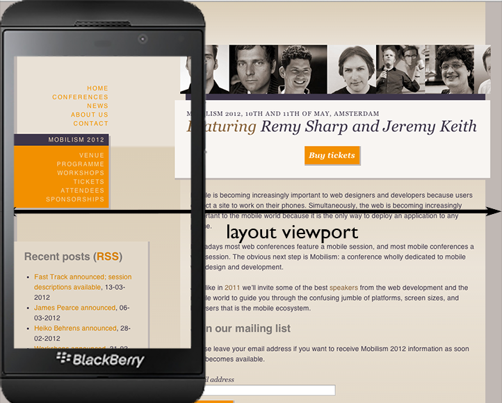

Back in September I noticed a [question by Declan Chidlow](https://front-end.social/@vale@fedi.vale.rocks/117199889590049689), who wondered if `initial-scale=1` is still necessary in meta viewport boilerplate - a question that turned out to be asked first by [our gracious host](https://matuzo.at/blog/2026/html-boilerplate#viewport-essential). Since I happen to be partly responsible for putting it in the boilerplate - dare I say it? - initially, my interest was piqued.

Doing the research and writing this article was fun, especially when I realised that, while AI could have written this article if I gave it notes, it cannot do original browser compatibility research.

## The change

I started studying mobile browsers in 2009 and became a thought leader for a while because there were few others thinking about the mobile web. One of my areas of expertise is the viewports. Back in 2011 or so I evangelised the old meta viewport version, the one that should be replaced, pretty heavily because at that point it worked best across browsers for reasons I'll explain later.

```html
<meta name="viewport" content="width=device-width,initial-scale=1">
```

Since in those days everybody still did as I told them, that message was picked up and the meta viewport became boilerplate.

Last September, we found that the situation has changed, and that `initial-scale=1` is not _required_ any more. We should change the boilerplate code to:

```html
<meta name="viewport" content="width=device-width">
```
It's fitting that I do my part in revising the boilerplate, even though people found better use of their attention span than listening to me.

While `initial-scale=1` is not required any more, it's still an _option_. There is a very specific class of problems with elements sticking out of the viewport that `initial-scale=1` hides from view. That's why, until recently, these problems were ignored by some web developers, and possibly even by certain browser vendors. (Contrary to custom, "certain browser vendors" does not refer to Apple here.)

If your site has such issues and you can't fix them, it's a good idea to continue using `initial-scale=1`.

<figure>


<figcaption>The site appears to be perfectly suited for mobile screens ... but the element that sticks out of the viewport will cause trouble later on.</figcaption>

</figure>

## Viewports

Before we can dig into the details you need to understand what a viewport is, and why you'd want to set it. Skip this section if you already know.

Take this HTML/CSS.

```html
<html>
  <body>
    <div>
    </div>
  </body>
</html>
```

```css
div {
	width: 100%;
}
```

Me: How wide is the div?  
You: Well duh. 100%.  
Me: 100% of _what?_  
You: Of the window!  
Me: Correct. Why?  
You: Errr ... because it tells you how wide the site is?

(Incidentally, if you encounter percentages in CSS, always ask _percentage of what?_ The answer is usually quite revealing and helps you understand CSS better.)

The browser window doubles as the **viewport**, also known as the initial containing block. A CSS layout must know how much space, how many pixels, it has to lay itself out in. If your desktop window is 700px wide, the div will be (roughly) 700px wide. If it's 1289px, the div will be (roughly) 1289px wide. If you resize the window, the div gets resized. That's how it has always worked on desktop.

### The mobile viewport

Before the iPhone, nobody tested their sites in widths less than 800 pixels wide, because _obviously_ everyone used a monitor of at least that size. In particular, CSS relative units, mostly % in those days, assumed a viewport of at least 800px.

But a mobile screen is a lot smaller than a desktop one, especially fifteen years ago. Around 360 was a decent-sized mobile one in those days. Those narrow screens could do terrible things to websites if they'd copy desktop browser behaviour literally. CSS percentages, especially, would start to misfire. Mobile browser vendors had to find a solution to this problem.

<figure>


<figcaption>A desktop-only site on a narrow mobile screen, if that screen doesn't do something clever with the viewport. It's clear no one ever tested the site on this narrow of a viewport.</figcaption>

</figure>

Nokia and BlackBerry used a desktop-sized viewport, even though it was way larger than desirable on their devices. This kept the desktop-centric sites looking decent, but users always had to zoom and/or scroll to get a full view of the site. Still, desktop-only websites sort-of worked, and that was the point of the exercise.

<figure>


<figcaption>A desktop-only site in a desktop-like viewport. It works, but the user must zoom in before doing anything else.</figcaption>

</figure>

Apple improved on that solution. By default the brand-new Safari on iOS browser would use a 980px-wide desktop-like viewport, just as Nokia and BlackBerry did, but a site could also use a much narrower 320px viewport that suited the early iPhone screens perfectly.

Crucially, Safari would only do so if the web developer signalled that the site was ready for narrow mobile screens by explicitly opting into the behaviour. The opt-in mechanism was the meta viewport.

<meta name="viewport" content="width=device-width">

Then a bright lad called Ethan Marcotte [made the case](https://alistapart.com/article/responsive-web-design/) for combining the meta viewport with another exciting new technology called media queries, and responsive design was born and the mobile web took off and we never looked back.

<figure>


<figcaption>A mobile-optimised site uses the meta viewport to narrow its layout viewport and combines it with media queries to figure out the current width of the viewport and respond to it.</figcaption>

</figure>


### Types of viewports

There are two viewports, the layout and the visual, and the layout viewport has two pre-programmed possible values as well as an actual value. I'm going to use these names in the rest of this article, so please study them for a minute.

If you are have trouble visualising all of this, don't worry. You're not the only one. Use my aptly-named [Viewports visualisation app](https://www.quirksmode.org/mobile/viewports/) to understand what's going on. Best viewed with a desktop browser.

#### Layout viewport

The width (and height) that CSS uses for its initial containing block. The full page is this wide (unless content sticks out). The layout viewport has two pre-programmed values it can use, but isn't restricted to them.

#### Default layout viewport

Pre-programmed value 1: The layout viewport you get without a meta viewport tag. Tends to be between 800 and 1024px wide; Apple uses 980px.

#### Ideal layout viewport

Pre-programmed value 2: The layout viewport you get with the standard meta viewport tag. The browser vendor considers this width to be ideal for the device.

#### Actual layout viewport

The layout viewport your site actually uses. Usually one of the two pre-programmed ones.

#### Visual viewport

This is the part of the page that you see on-screen. It may be the actual layout viewport, but when you zoom it may become smaller (or sometimes larger).

Without the meta viewport, the actual layout viewport becomes equal to the default layout viewport. The meta viewport sets the actual layout viewport to a width of your choice, with the `device-width` keyword triggering the ideal layout viewport.

<figure>



<figcaption>The layout viewport tells CSS how much space it has, and is especially important for % sizes.</figcaption>

</figure>

<figure>


<figcaption>The visual viewport describes the part of the layout viewport the user is currently seeing.</figcaption>

</figure>


## De-facto standard

Apple provided the meta viewport, while Nokia and BlackBerry provided a bunch of JavaScript properties that gave information about the viewports. This led to a de-facto standard that was eventually - with a little help from yours truly - supported by all browsers by late 2010 - and back then "all browsers" was a hell of a lot more than three. (Things changed later, but that's beyond the scope of this article. Read [this blog post](notyetwritten) for an overview of the current situation.)

But there never was an official specification, not even today. There's a [draft](https://drafts.csswg.org/css-device-adapt/), and when I researched this article I found that was updated recently and is moving in the [right direction](https://www.quirksmode.org/blog/archives/2015/09/a_new_device_ad.html). That's great news, but it's the first time that an official W3C viewports document bears a resemblance to reality.

The fact that there was no official spec meant that some properties of the meta viewport were hard to discover and others were weird.

### Little-known facts

Here are a few not-so-well-known facts that I discovered during my [tests](https://quirksmode.org/mobile/tableViewport.html); see also my [test pages](https://quirksmode.org/m/tests/viewports/).

Did you know that you're not required to use `device-width`? The following also works; the layout viewport width becomes 400px:

```html
<meta name="viewport" content="width=400">
```

Did you know you can set an effective min-width for your viewports? If `width` and `initial-scale` contradict one another, all browsers pick the largest value. So this means "make the layout viewport the ideal size, but at least 400px" - also when you change device orientation.

```html
<meta name="viewport" content="width=400,initial-scale=1">
```

(I'll explain `initial-scale` in a minute.)

Did you know it is possible to change the layout viewport width after page load? All browsers change the size of the layout viewport to 500px with the following code:

```js
let viewport = document.querySelector('meta\[name=viewport\]');
viewport.setAttribute('content','width=500');
```

These effects have not been used much in the last fifteen years. I think they'll remain curiosities forever. Don't let that stop you from experimenting, though.

### device-width and landscape

A phone in landscape mode has a wider screen than one in portrait mode. Thus, the ideal layout viewport, the `device-width` one, should also be wider. Sounds reasonable, right?

From the release of the original iPhone to somewhere between 2017 and 2026, Safari/iOS used the same ideal layout viewport for portrait and landscape. All other browsers change the actual layout viewport width when you go from portrait to landscape and back. It’s the only aspect of the meta viewport where all other browsers overruled Safari.

Apple never talks about these things, but my guess is that they decided that changing it on each orientationchange was programmatically too expensive for 2007 hardware. Remember, if the actual layout viewport changes the entire layout of the site has to be re-calculated because the CSS percentages change. On the other hand, no other phone ever felt the need to protect its performance in this specific way, so I may be wrong.

(Incidentally, the same is still the case with `screen.width`. This property, which is different in all other browsers in portrait and landscape, is the same in both orientations in Safari. That's why your analytics package never shows any iOS visitors in landscape mode.)

This was a serious incompatibility between Safari on the one hand and all other browsers on the other. How to solve this conundrum?

### initial-scale

Well, Apple solved it for us, by giving us a second method to set the layout viewport. You see, `initial-scale=1` does the same as `width=device-width`, except that it makes the layout viewport wider if you switch to landscape even in Safari.

Officially `initial-scale` sets the initial zoom level of the page. (Why is it called scale? Ask Apple.) And what is the reference frame? If we use scale=1, what is the zoom level equal to? This turns out to be the ideal viewport.

So `initial-scale=1` sets the initial zoom level to the ideal viewport size and makes sure it stays there even in the more complicated circumstances that we'll treat later. That makes sense. You'd expect that.

It _also_ sets the layout viewport to the ideal viewport size, and all other browsers copied this behaviour. Why does that make sense? Dunno. Ask Apple. But this is what it does in all browsers.

(It's also consistent. In all browsers, `initial-scale=2` sets the actual layout viewport to half the ideal size, while `initial-scale=0.5` sets it to double the ideal size.)

### Boilerplate

In other words, despite it making little theoretical sense, `initial-scale=1` gives us a `width=device-width` that also reacts to an orientationchange in Safari.

So secretly, this code alone has always been enough to trigger the ideal layout viewport width:

```html
<meta name="viewport" content="initial-scale=1">
```

Then why don't we use this instead for our boilerplate? Three reasons:

1.  At the time I found out how all this worked, IE10 Mobile had the exact opposite bug to Safari: `initial-scale=1` would fix the layout viewport in portrait mode. Using both kept both browsers on board. (Meanwhile ... let's say IE10's relevance decreased rather markedly.)
2.  It has side effects. We'll encounter one later in this article.
3.  It made no sense to me. If we want to set the layout viewport, let's set the layout viewport instead of making this weird detour through a zoom level called scale. (This is a value judgement, I admit.)

And that's how we ended up with our boilerplate.

```html
<meta name="viewport" content="width=device-width,initial-scale=1">
```

## A new class of errors

Let's move from 2011-ish to today. In September, we found that somewhere in the last nine years Safari/iOS changed its behaviour around `width=device-width`. The layout viewport width now changes when you go from portrait to landscape mode. Thus, `initial-scale=1` is no longer necessary for Safari and we can simplify the boilerplate code:

```html
<meta name="viewport" content="width=device-width">
```

When [we told](https://vale.rocks/micros/20260902-1350) [the world](https://www.quirksmode.org/quirksblog/2026/0902-initial.html) about this fact, the most common reaction was a sort of plaintive mooing "Hey, my site looks weird now!"

### The problem

Previously, if an image or other element was too wide for the layout viewport, `initial-scale=1` papered over the problem by zooming in to the proper level and hiding the issue from casual observation. You could still scroll or zoom out to see the element, but nobody did so. Not even the site creators.

<figure>


<figcaption>An element sticks out of the layout viewport. The site is zoomed in to the ideal layout viewport, though, so few people notice.</figcaption>

</figure>

Without `initial-scale=1`, however, browsers zoom out in order to accommodate the entire element. (Note that the layout viewport stays the same; it's the visual viewport that expands.)

<figure>


<figcaption>The same element sticks out of the layout viewport. There is no initial-scale. Now the browser zooms out to accommodate the element.</figcaption>

</figure>

### Plaintive mooing

The question is whose mistake this is. In my view, browsers do little wrong - though we will see that Safari gets it a little more right than the other browsers. They deal with the problem of too-wide elements in such a way that those elements remain accessible, even though aesthetics suffer.

Also, they handle `initial-scale=1` in a predictable and time-honoured (though weird-from-a-theoretical-perspective) fashion, and a side effect happens to be that too-wide elements are hidden from casual inspection.

Maybe it's the casualness of the inspection that is to blame?

One potential solution is to fix the page. If there are no elements sticking out of the viewport there is no problem. But fixing issues does not appear to be an option. Plaintive mooing is much more fun.

Fortunately, there's a second option: continue using `initial-scale=1`. The fact that it's not part of the default any more doesn't mean you can't use it. Stick it back in the meta viewport if you need it.

But even that suggestion is met by more mooing. It turns out to be surprisingly difficult to explain that "not the default" is different from "do not use", so I asked ChatGPT to come up with a paragraph a 10-year old would understand. Here it goes:

> You don’t need to use `initial-scale=1` anymore because websites will automatically fit the screen properly without it. But if you notice that images are too big and stick out of your website, you can still use it to help fix the problem.

For more information please reread.

### The facts

When I'd come this far and was feeling smug and superior, I noticed a problem on two of my sites. There were elements sticking out of the viewport, and the browsers zoomed out to accommodate them. The reason I hadn't noticed them before was that `initial-scale=1` hid them from casual inspection - until I removed it.

This was an outrage! This was not about some random dude but about me. _Me!_ The situation was getting _way_ out of hand! Sound the alarm bell! Somebody really ought to do something!

Would that someone have to be me? Who else? Not some random mooing guy on the Internet, that's for sure.

I first fixed the problem. There were horizontal bands of images, and the total minimum width of the images was too large. I implemented the obvious solution by shrinking the minimum image widths. That made the problem go away. I mooed once, just for funsies.

Then I wondered what was really going on and ran some [tests](https://quirksmode.org/m/tests/viewports/). I found the following:

1.  With `initial-scale=1`, the site looks normal. Users can scroll right to view the entire too-wide element, but there is no obvious indication that there's more content to be seen. Web developers may also miss it.
2.  Without `initial-scale=1`, all Android browsers zoom out so that the entire element is visible. Tested up to a 2000px-wide element in Chrome, Vivaldi, UC, Firefox, and the Android WebView on Android 15.
3.  Without `initial-scale=1`, Safari and the iOS WebView do something different: they zoom out as well, but only up to about 600px, even if the element is wider. This effect is much more subtle, and I find I like it.  
    Once the element passes 1860px in width Safari hides the overflow entirely as if `initial-scale=1` is present.  
    (Why 1860px? Because it's twice the default layout viewport of 980px. (Why twice? Beats me. Ask Apple.)) Tested only on iPhone iOS 26.

Apple's approach is clearly superior, and I hope the other browsers copy it. It also made me wonder if the other browsers maybe overlooked these issues because `initial-scale=1`, which everybody uses anyway, papered over them.

### How to use the new boilerplate

By default, use this boilerplate, but be aware that there may be a problem.

```html
<meta name="viewport" content="width=device-width">
```

The use of `initial-scale=1` over fifteen years made us (not only web developers, but maybe also certain browser vendors) fairly lackadaisical about elements sticking out of the narrow mobile viewport. It's time to clean up these problems.

In new projects, use just `width=device-width`. It'll help you avoid the too-wide-element problem in the future.

Test your older sites by removing `initial-scale=1` and seeing what happens. If browsers zoom out, you know what the problem is. Try to fix it; sometimes that's easy, and sometimes that's hard. If it's too hard for now, just re-insert `initial-scale=1` and make a note somewhere in a bug tracking system.

The old way is not wrong or bad, it's just not the default any more. But it's still there. Use it if you need it.

But do not moo.
